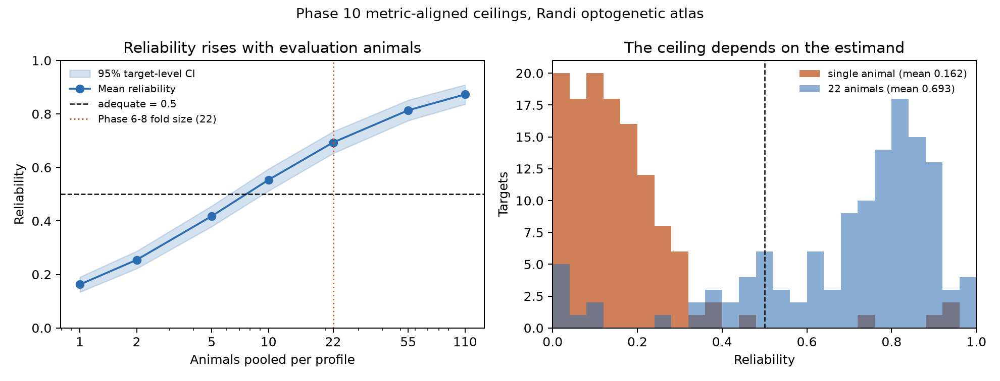

# NeuroBranch

An end-to-end, leakage-safe research platform for *C. elegans* whole-brain
population dynamics, latent branching, and **model-dependent virtual
perturbation** on real calcium imaging and optogenetic atlases.

> **Epistemic status.** Every intervention output is a model-dependent virtual
> perturbation, not a causally validated effect. The models are fitted to
> observational recordings; no animal was perturbed for this project. A
> visually attractive branch is not a bifurcation, and good observational
> prediction is not causal identification. The evidence gate in
> `interventions/safety.py` refuses to label any output as empirically
> validated without a matched, provenance-checked intervention dataset.

## What version 1.0.0 adds: metric-aligned evaluation

Version 1.0.0 attaches every number to the estimand it actually describes. The
Phase 9 audit correctly found that the atlas is measurement-limited for
individual animals; it then applied that single-animal ceiling to pooled
metrics, which was wrong. Phase 10 separates the two and fixes two estimator
defects (sparse-responder denominators and a double-counted interaction term).

| Quantity | Estimate | 95% interval | Ceiling |
| --- | ---: | --- | ---: |
| Repeat reliability (within animal) | 0.243 | [0.206, 0.279] | 0.493 |
| Single-animal reliability | 0.162 | [0.134, 0.191] | 0.403 |
| Pooled over 22 animals (Phase 6-8 fold) | 0.693 | [0.653, 0.734] | 0.833 |
| Pooled over all 110 animals | 0.873 | [0.837, 0.909] | 0.934 |

The consequence is narrow and important. Claims about one animal are severely
bounded. Claims about a pooled population mean are not, and the Phase 6-8 models
sit far below that ceiling rather than against a measurement wall. The CRO of
0.0984 is about **11.8%** of its metric-aligned ceiling, so the old Phase 7
"64% of ceiling" claim remains withdrawn and the Phase 9 replacement (21%) is
withdrawn too.

The Phase 8 pair advantage (+0.0442, CI [+0.0080, +0.0901]) still has a design
MDE of 0.0587 against a declared smallest effect of interest of 0.020, so it
remains **underpowered**. Two Phase 10 robustness results are deliberately
negative: target-level reliability rankings do not replicate across animal
halves (median Spearman about 0.00), and the animal jackknife interval does not reach
nominal coverage in simulation. Neither is used as an inferential interval. The
delete-one-animal aggregate spans [0.165, 1.000], so the fold-level mean is
fragile to a single animal; that is reported rather than hidden.



Read the audit in [`docs/PHASE10_RESULTS.md`](docs/PHASE10_RESULTS.md), the
estimator corrections in [`docs/CORRECTIONS.md`](docs/CORRECTIONS.md), the
limits in [`docs/MEASUREMENT_LIMITS.md`](docs/MEASUREMENT_LIMITS.md), and the
design calculator in [`docs/DESIGN_ENGINE.md`](docs/DESIGN_ENGINE.md).

## Install

Python 3.10-3.13.

```bash
python -m pip install -e ".[dev]"
```

Optional GPU extra: `pip install -e ".[dev,gpu]"`.

## Quick start

```bash
# Reproduce the metric-aligned ceilings, robustness checks and claims
python scripts/phase10_reliability.py
python scripts/phase10_figure.py
python scripts/phase10_robustness.py
python scripts/phase10_design.py
python scripts/phase10_claims.py --check
python scripts/validate_reports.py --strict

# Or through the CLI
python -m neurobranch.cli.main benchmark reliability
python -m neurobranch.cli.main benchmark claims
python -m neurobranch.cli.main version

# Interactive app (14 tabs)
streamlit run app/streamlit_app.py
```

## Reproduce the phases

| Phase | Command | What it produces |
| --- | --- | --- |
| Data audit | `neurobranch data audit` | Kato archive verification |
| Phase 2-4 | `neurobranch train`, `simulate`, `branching` | Baselines, branching, intervention audits |
| Phase 6-8 | `python scripts/phase8_run.py` | CRO and adaptive-twin evaluation |
| Phase 9 | `python scripts/phase9_reliability.py` | Historical single-animal audit |
| Phase 10 | `python scripts/phase10_reliability.py` | Metric-aligned ceilings, curve, components, manifest |
| Phase 10 robustness | `python scripts/phase10_robustness.py` | Summary sensitivity, half-split, jackknife |
| Phase 10 claims | `python scripts/phase10_claims.py` | `reports/phase10/claims.json` |

Every artifact directory carries a manifest with the input hash, git revision,
parameters and library versions.

## Evaluation contract

1. **Animal-disjoint splits.** Events from one animal never appear in both
   training and test.
2. **Ceiling before score.** Report reliability and the attenuation ceiling next
   to every held-out correlation.
3. **MDE before difference.** Report the minimum detectable effect next to every
   claimed difference.
4. **Fixed claim statuses.** `supported`, `not_supported`, `bounded_null`,
   `underpowered` - assigned by code, not by hand.
5. **No causal language.** Virtual perturbation is model-dependent; the word
   "validated" is reserved for matched interventional evidence.

These rules are implemented in `src/neurobranch/benchmark/` and documented in
[`docs/BENCHMARK_CARD.md`](docs/BENCHMARK_CARD.md) and
[`docs/CLAIMS.md`](docs/CLAIMS.md).

## Repository map

```
src/neurobranch/
  benchmark/        reliability, robustness, power/MDE, claims ledger, reporting
  design/           ceiling-targeted animal budgets and coverage study
  dynamics/         latent models, training, splits
  branching/        empirical and model-based branching analysis
  interventions/    virtual perturbation engine and safety gate
  twin/             adaptive twin and active probing
  cli/              Typer CLI
app/                Streamlit + Plotly interface (14 tabs)
scripts/            phase10_* (reliability, figure, robustness, design, claims), validate_reports
reports/            generated artifacts, including phase9/ and phase10/
docs/               phase reports, benchmark card, claims policy, corrections
schemas/            JSON schemas for generated reports
tests/              unit, integration, scientific and benchmark tests
```

## Datasets and primary sources

- Kato et al., *Cell* 2015, whole-brain calcium imaging:
  [`10.1016/j.cell.2015.09.034`](https://doi.org/10.1016/j.cell.2015.09.034)
- Randi et al., *Nature* 2023, optogenetic atlas:
  [`10.1038/s41586-023-06683-4`](https://doi.org/10.1038/s41586-023-06683-4)
- Baskoylu & Flavell, Dryad 2026:
  [`10.5061/dryad.w9ghx3g4v`](https://doi.org/10.5061/dryad.w9ghx3g4v)
- Kramer et al., *Nature Neuroscience* 2026:
  [`10.1038/s41593-026-02257-5`](https://doi.org/10.1038/s41593-026-02257-5)

Provenance and hashes are recorded in [`docs/DATA_PROVENANCE.md`](docs/DATA_PROVENANCE.md).
The atlas is used under its source terms; check each archive before
redistribution.

## Testing and CI

```bash
pytest -q            # 147 tests
ruff check src tests scripts
```

GitHub Actions runs the suite on Python 3.10 and 3.13, lints, and validates the
Phase 9 reports against their JSON schemas.

## Limitations

- The atlas is measurement-limited: single-animal reliability is about 0.22.
- Reliability is estimated on the same atlas used for evaluation.
- No causal claim is made anywhere in this repository.
- The design engine (EIG portfolios, simulation-based calibration) is not
  implemented; the measurement audit had to come first.
- Phase 6-8 intervals use animal-level folds but the MDE reconstruction assumes
  independent units, so design resolution is approximate.

## License

MIT for the code. Datasets retain their original licenses.
