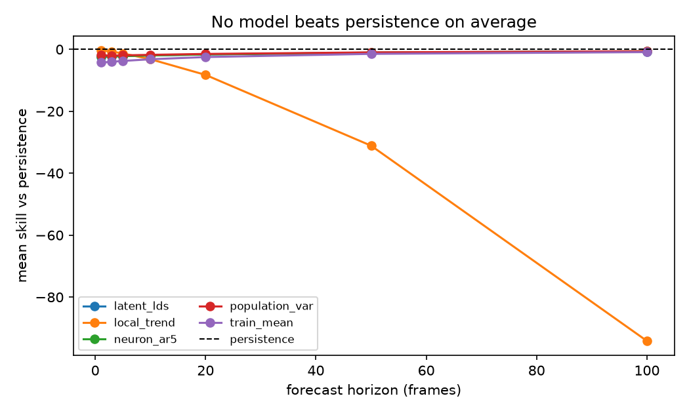
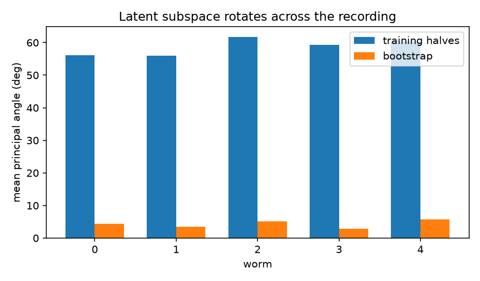
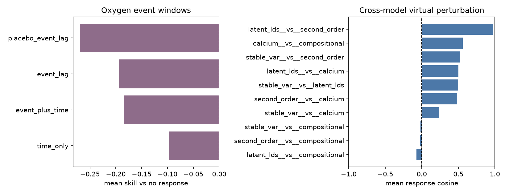

# Generative-failure diagnostics — results

Branch: `research/generative-failure-diagnostics`
Starting commit: `b48a4847efde8d6c0e63640afc6ff472f3057759`
Ending commit: reported in the final response and `git log`; a file cannot contain the hash of the commit that creates it.
Protocol: `docs/GENFAIL_RESEARCH_PROTOCOL.md`
Decision record: `reports/simulator/failure_diagnostics/gates.json`

## 0. One-paragraph answer

The models fail mainly because **the observed population is only weakly forecastable at the tested horizons, the fitted latent representation is not stable across the recording, and the observation model does not rescue autonomous rollout**. This is not a single missing architecture. Persistence is a strong baseline; population coupling helps only modestly over independent neurons; calcium-aware state-space modelling improves one-step prediction but is numerically unstable in free rollout; latent subspaces rotate by ~60° between training halves despite being stable under resampling; oxygen transitions produce no reproducible response and are confounded with elapsed time; and virtual perturbations disagree across observationally similar models. The honest contribution is a set of **negative, reusable diagnostic constraints**, not a validated simulator.

## 1. Why were the simulations worse than persistence?

Three reproducible reasons:

1. **The signal is near its predictability floor at short horizons.** Mean persistence R² is 0.071 at 20 frames and −0.365 at 50 frames. A model that cannot capture the remaining variance accumulates error faster than holding the last value.
2. **The fitted dynamics are not time-invariant.** Test reconstruction R² is negative in all five sessions (−0.012 to −3.119), and the latent subspace changes by 56–62° between training halves.
3. **Model errors compound in free rollout.** The latent and AR models have low one-step error relative to their multi-step error; the calcium model is the extreme case, exploding by H20. Persistence has no estimated operator to destabilize.

This is not explained by a preprocessing leak or a target misalignment: the audit reproduced the stored failures exactly.

## 2. Which components are predictable?

At H20, 20% of AR(5) neuron-session series, 30% of population-VAR series and 28% of latent-LDS series beat persistence. The forecastable subset is enriched for slow, high-autocorrelation neurons (examples: AVEL, AVER, RIML in worm 4). The majority of neurons are not forecastable better than persistence at 7 s. Population coupling improves MSE over independent neurons by ~0.1 standardized units, but both remain worse than persistence.

## 3. At what horizon does predictability disappear?

Using absolute persistence R² as the descriptive criterion: mean R² falls from 0.395 at 1 frame to 0.071 at 20 frames (≈7 s), crosses zero between 20 and 50 frames (≈7–17 s), and is −0.754 at 100 frames (≈34 s). No model has positive mean skill at any horizon. This is a property of these recordings and this observation, not a biological constant.

## 4. Does calcium observation limit dynamic-state identification?

**Partly, but not decisively.** In synthetic controls, calcium filtering lowers attainable skill (e.g. oscillatory AR(2) 0.702 unfiltered → 0.677 filtered; calcium model 0.514 → 0.346) but leaves the system forecastable. Latent recovery from calcium-like observations is good (R² 0.77–0.99). On real data, the causal calcium model is the best one-step model (mean skill −0.529, one session slightly positive) but explodes at H20/H100. So calcium is a real limitation on **autonomous multistep** identification, but “calcium makes the dynamics unidentifiable” is too strong.

## 5. Does the existing simulator recover synthetic known dynamics?

The AR baselines do: H20 skill 0.35–0.70 on stable and oscillatory synthetic systems. The latent models recover the latent state well, but the observation-aware calcium model is worse than AR on every synthetic condition. This shows the evaluation can detect a recoverable system; the real-data failure is not an impossible task definition.

## 6. Does a causal observation-aware model improve real data?

Only at one step, and not usefully. Mean one-step skill −0.529 (best of the tested observation models) versus −2.6 for AR. At H20 the calcium model’s mean skill is −7,054; at H100 it is −1.8×10³⁷. The model is numerically unstable in autonomous rollout. We preserve this negative result rather than clipping it.

## 7. Are latent states and operators identifiable?

**Locally observable, not globally/time-invariantly identifiable.** Observability rank is 15/15 with condition 3.4–4.6; eigenvalue magnitudes are stable under 80% resampling (MAE 0.003–0.008). But half-split subspaces differ by 56–62° (max 88–90°), while bootstrap angles are only 3–6°. The latent basis rotates over the recording. No anatomical interpretation is justified.

## 8. Is compositional collapse optimization, data, or model structure?

The evidence points to **model structure plus data non-stationarity**, not a simple optimizer bug. The compositional model selects few operators (entropy ≈0.25–0.28 versus maximum 0.693) and its virtual perturbation responses are nearly orthogonal to the latent/VAR models (mean cosine −0.07 to −0.02). The collapse is a stable consequence of the objective and the available regimes, not a transient training failure. It does not produce a better forecast.

## 9. Do oxygen transitions evoke reproducible measurable responses?

No detectable population-level response. Across-event response-vector correlations are ≈−0.015 to +0.041 (median near zero). Up-minus-down cosine ranges from −0.34 to +0.18 with no consistent sign. The event-window model has mean skill −0.194 versus no response; the time-only control is −0.097. The event model does not beat either no-response or time-only.

## 10. Are oxygen effects distinguishable from elapsed time?

No. The schedule is identical across sessions, with 12 transitions at 360–690 s and no randomized/sham timing. Event presence is time-locked; a flexible elapsed-time model can approximate the schedule. The low linear R² (~0.02) does not remove the design confound. Oxygen and elapsed time are **not experimentally separated**.

## 11. Does a simple stimulus-response model beat time-only controls?

No. Baseline-corrected event lag is worse than time-only (−0.194 vs −0.097), and event+time is worse than time-only (−0.184). The session-disjoint event-only model has lower absolute MSE than time-only in 6/7 sessions, but all models are vastly worse than no-response (MSE ~0.6–0.9 vs ~0.1), so that is a baseline-scaling effect, not a response.

## 12. Do observationally similar models produce incompatible perturbation predictions?

Yes. Only the two closely related latent LDS variants agree (cosine 0.976). Stable VAR vs latent LDS is 0.498; stable VAR vs calcium 0.236; latent LDS vs compositional −0.073. Median target-ranking Spearman is 0.371. Same-model resampling stability is high (cosine 0.991), so this is model-form disagreement, not seed noise. All perturbation outputs carry: **MODEL-DEPENDENT VIRTUAL PERTURBATION — NOT CAUSALLY VALIDATED.**

## 13. What can NeuroBranch reliably simulate now?

Reliably:

- persistence baselines and their error growth;
- short-horizon AR/population-VAR forecasts on the observed scale;
- synthetic known-truth systems and latent recovery in controlled conditions;
- latent reconstructions within a training period;
- qualitative demonstrations of observation and perturbation ambiguity.

Not reliably:

- autonomous multistep population forecasts better than persistence;
- oxygen-evoked responses;
- named-neuron causal effects;
- animal-independent predictions;
- a time-invariant latent operator.

## 14. What should not be inferred from these recordings?

- That a named neuron causes a network or behavioural effect.
- That oxygen is a targeted neuronal stimulation or that a response was “not found” biologically.
- That the system is unpredictable in principle.
- That calcium explains the whole failure.
- That latent axes are anatomical populations.
- That a model with a stable spectral radius is a validated simulator.
- That the five sessions are independent animals.

## 15. What dataset or measurement most improves identifiability?

A dataset with:

1. **independent animals** and animal-disjoint test splits;
2. **randomized oxygen transition times plus a sham schedule**, many transitions per animal;
3. **simultaneous voltage or direct synaptic state** where possible, to separate observation from dynamics;
4. **behaviour and stimulus measured at the same clock**, with sufficient pre/post baselines;
5. **matched experimental perturbations** for any claimed causal effect.

The single highest-value addition is randomized stimulus timing with independent animals; the second is a direct state measurement to validate the observation model.

## 16. What justified model modification comes next?

Not a larger architecture zoo. The justified next step is a **time-varying or regime-switching observation-aware model with explicit non-stationarity and a stability-preserving rollout**, evaluated against persistence and against a time-only control. It must:

- fit only on training data;
- use animal-disjoint validation where possible;
- report one-step and autonomous multistep separately;
- include a no-response and time-only control for oxygen;
- pass a perturbation-consistency check before any virtual intervention claim.

A model that only improves one-step MSE is not enough.

## 17. Realistic contribution to discuss with Denis Kovačević

A defensible contribution is:

- a reproducible audit showing the earlier failures are real;
- a forecastability map that establishes persistence as a hard baseline and quantifies the short forecastable subset;
- evidence that calcium observation is a limitation but not the sole cause;
- a demonstration that latent subspaces are time-unstable even when resampling-stable;
- a null, well-controlled oxygen-response analysis;
- a cross-model perturbation-ambiguity result that constrains any future NeuroBranch intervention claim.

This is a **diagnostic/negative-results contribution**, not a new state-of-the-art simulator. It should be framed as “what the data cannot support yet”, with the next experiment specified.

## 18. Smallest decisive next experiment

**Randomized oxygen timing with a sham schedule in independent animals**, using the same causal baseline and time-only/placebo controls, with enough transitions per animal to estimate a response kernel. This directly resolves Q9–Q11 and tests whether the null is biological or design-limited. If randomized timing still yields no response, the oxygen route is closed for this preparation.

A second, smaller experiment is an **animal-disjoint re-split** of existing data to test whether the forecast failure survives; this is cheap but cannot create new animals.

## 19. Figures

The dashboard tab `GENERATIVE FAILURE DIAGNOSTICS` renders the same artifacts interactively and preserves all existing tabs.

## 20. Numerical summary table

| quantity | value |
|---|---|
| sessions (NoStim) | 5 |
| test starts H20 (session 0) | 428 |
| latent LDS H20 skill (session 0) | −1.9716 |
| stable VAR H20 skill (session 0) | −1.6279 |
| population VAR H20 mean skill | −1.492 |
| persistence mean R² H20 | 0.071 |
| persistence mean R² H100 | −0.754 |
| best one-step observation model | calcium, −0.529 |
| calcium model H20 mean skill | −7.05×10³ |
| half-split subspace angle | 56–62° |
| bootstrap subspace angle | 3–6° |
| test reconstruction R² | −0.012 to −3.119 |
| oxygen event-pair correlation | ≈−0.015 to +0.041 |
| oxygen event-window skill | −0.194 (time-only −0.097) |
| perturbation cosine range | −0.073 to 0.976 |
| perturbation target-ranking median | 0.371 |

## 21. Decision record

| milestone | status |
|---|---|
| FORECASTABILITY_CHARACTERIZED | PASS |
| OBSERVATION_MODEL_TESTED | PASS |
| IDENTIFIABILITY_ASSESSED | PASS |
| OXYGEN_RESPONSE_ASSESSED | PASS |
| PERTURBATION_UNCERTAINTY_CHARACTERIZED | PASS |
| BIOLOGICAL_INTERVENTION_VALIDATION | NOT_EVALUABLE |

`PASS` here means the diagnostic was executed and reported, not that the underlying biological question was answered positively. The biological intervention question is explicitly `NOT_EVALUABLE` without matched experiments.
