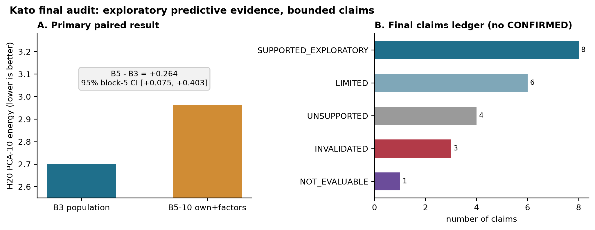
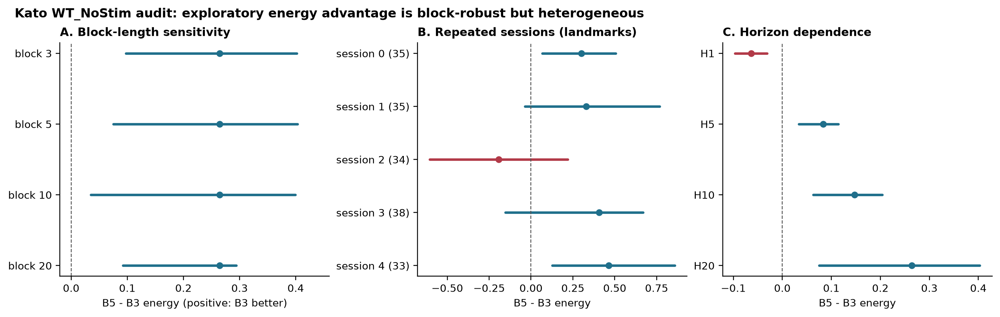

# Kato final audit: supervisor brief

**Audience:** Denis Kovačević; reader has not followed every phase.
**Status:** exploratory reanalysis. Not a thesis, not a systematic review, not a
confirmatory replication.

## What biological phenomenon motivated the project?

The project asks whether the collective activity of a small *C. elegans* neuron
panel contains predictive information about the population's future that is not
captured by each neuron's own past or by a low-dimensional shared-state summary.
The long-term motivation is a model that could support intervention-aware
simulation; the current data are observational, so the defensible object is
prediction, not biological control.

## Which recordings were used?

Only Kato et al. (2015) wild-type, unstimulated, immobilised recordings
(`WT_NoStim`): five repeated sessions, 15,662 frames, native panels of
103/127/123/118/121 neurons. The five sessions are **not five confirmed
independent animals**. No WT_Stim, Nichols, Dunn, Randi, Baskoylu or Atanas data
were used. The temporal test tails have been reused across project phases.

## What is the strongest positive predictive result?

A full lag-one population VAR (B3) has lower H20 PCA-10 energy than a matched
own-neuron-plus-ten-common-factor model (B5-10):

```text
B3 energy       2.7001
B5-10 energy    2.9646
B5 - B3        +0.2644
block-5 95%    [+0.0750, +0.4031]
B3 better      64.0% of 175 landmarks
```

Positive means B3 is better because energy is lower-is-better. The advantage is
positive at H5–H20, reverses at H1, and is positive in four of five repeated
sessions (session 2 reverses). It is a fixed-PCA **energy** result; MSE and
neuron-space intervals are mixed.

## Which simpler controls were tested?

Persistence; matched own AR at 200 and 500 frames; own AR plus local linear drift;
B5 with 1, 3, 5 and 10 training-only PCA factors; circular and block shuffles;
common-preserved residual shifts; residual-preserved factor shifts; and synthetic
systems with independent, common-only, direct-coupling and time-varying-common
structure. B1m and B4m are the relevant own-history baselines; B4m is deliberately
weaker than B1m.

## What does the ten-factor control establish?

The evaluation PCA and the common-factor PCA are the **same training-only
10-component transform** (54.7–71.0% variance by session). B5 therefore retains
all ten evaluation dimensions; it does not discard them by compression. It also
includes each target neuron's own current value.

What B5 cannot represent is arbitrary **other-neuron residual** coordinates. Its
residual-source operator is restricted to one own-row direction per output neuron;
B3's residual rows are 98.6–99.9% outside that pattern. This proves B3 has access
to residual cross-neuron information B5 lacks. It does **not** prove that this
access causes the score advantage, because B3 also has 7.96–9.95× more parameters.
Separating information from capacity would require a new prespecified restricted
model or independent data; no such model was tuned on the reused test tails.

## What is not identifiable from the existing data?

- A stable pairwise interaction graph. Off-diagonal coefficients correlate only
  `0.052` across chronological segments; the operator is not reliable as a graph.
- Biological connectivity, synapses, gap junctions or a command neuron.
- A unique “51% common / 49% residual” variance partition. Those are ordered
  descriptive increments; with B1m as baseline the shares are 23.5%/76.5%.
- Animal-level generalization: the intervals resample overlapping landmarks
  within five repeated sessions.
- Probabilistic calibration: `PROBABILISTIC CALIBRATION NOT ESTABLISHED`.
- Any biological intervention effect: `NOT_EVALUABLE`.

The residual predictive association is compatible with unmeasured common input,
nonlinearity, slow state, estimator capacity and neuron-specific dynamics. The
current design cannot choose among them.

## Why are virtual neuron perturbations not validated?

A perturbation is a `+1 SD` mathematical displacement inside a fitted linear
operator. Cross-fit response directions have median cosine `0.556`, with sign
reversals; there is no matched sham-controlled stimulation dataset. No neuron is
ranked as a target and no perturbation trajectory is a biological prediction.

```text
MODEL-DEPENDENT VIRTUAL PERTURBATION — NOT CAUSALLY VALIDATED.
Biological intervention validation: NOT_EVALUABLE.
```

## What is the smallest plausible MSc scope?

**Option A (recommended if the goal is a defensible predictive MSc):** an
independent-cohort, animal-level replication with a fixed training-only
representation, the B5-controlled H20 energy contrast as the single primary
endpoint, persistence and matched own-AR baselines, and animal-level resampling.
A negative result is still a result.

**Option B (only with suitable data):** a bounded intervention-design study with a
specified target, dose, timing, sham and outcome, plus a held-out-animal/-target
falsification test. It would deliver a protocol, not a causal simulator.

Neither option requires another architecture search on the reused test tails.

## Question requiring Denis's guidance

> For an MSc, is an independent-cohort, animal-level replication of the
> B5-controlled H20 energy contrast sufficient, or does the project need matched
> intervention data before the predictive result is scientifically useful?

This is the scope decision the current evidence cannot make for him.

## Reproduction and evidence status

A complete clean run of the official entry point finished normally in 2,005.9 s
with empty stderr. All 17 compared artifacts agree within `1e-8` (maximum
absolute difference `4.44e-16`; all gates match), so the result is
`FULL_END_TO_END_REPRODUCTION_PASSED`. The historical run itself was interrupted
and post-processed; the clean rerun is the reproduction evidence. The clean-rerun
details and all numerical discrepancies are in
`docs/KATO_FINAL_AUDIT_REPRODUCTION.md`; the 18 answers are in
`docs/KATO_FINAL_AUDIT_RESULTS.md`; the machine-readable ledger is
`reports/simulator/kato_final_audit/claims_ledger.json`.

**Strongest allowed sentence:** In five repeated Kato `WT_NoStim` recordings, a
full population VAR shows a modest, horizon-dependent exploratory H20 energy
advantage over a matched own-history-plus-ten-factor control, but the effect is
not uniform across sessions or representations and does not identify coupling.

## Figures and memo





Two-page memo: [KATO_FINAL_AUDIT_MEMO.pdf](../reports/simulator/kato_final_audit/KATO_FINAL_AUDIT_MEMO.pdf)

Every figure is a descriptive visualization of the frozen tables, not a new test.
The error bars are repeated-session/overlapping-landmark intervals.
