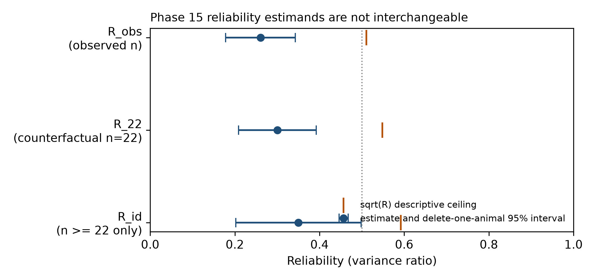
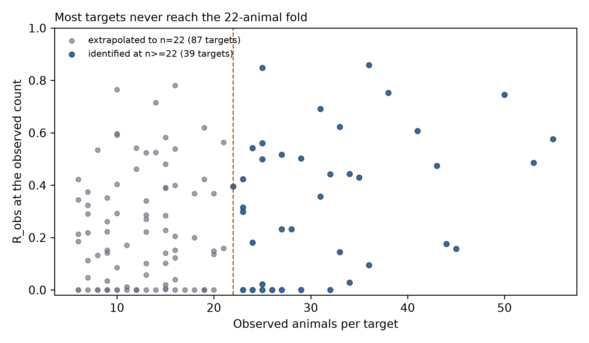
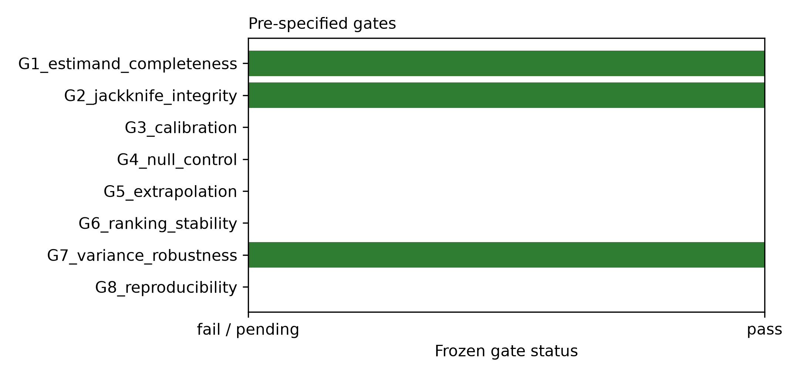

# Phase 15 results: reliability without extrapolation

**Status:** completed measurement audit; fail-closed negative result.
**Protocol:** `research/phase15_protocol.md` (frozen 2026-11-01).
**Decision:** `not_calibrated` (see `reports/phase15/summary.json` for the final
gate statuses).

## Headline

The Phase 11 claim that the coverage-aware reliability ceiling is **0.560** is
withdrawn as a bound. It is a historical extrapolated point estimate:
`sqrt(R(22))` with `R(22) = 0.3136` for 126 targets. Only **39 of 126** targets
have at least 22 animals; for the other **87**, `R(22)` is a design
counterfactual. The Phase 15 audit reports three estimands and does not choose
the most convenient one.

| Estimand | Population | Estimate | 95% delete-one-animal CI | Ceiling | Targets | Extrapolated |
| --- | --- | ---: | --- | ---: | ---: | ---: |
| `R_obs` | observed animal counts, all eligible | **0.2606** | [0.1782, 0.3430] | 0.5104 | 126 | 0 |
| `R_22` | counterfactual at 22 animals | **0.3006** | [0.2087, 0.3924] | 0.5482 | 126 | 87 |
| `R_id` | identified subset, `n >= 22` | **0.3501** | [0.2020, 0.4982] | 0.5917 | 39 | 0 |

`R_obs` is the descriptive observed-data quantity. `R_22` is a design
counterfactual. `R_id` conditions on larger targets and is a different
population; it is not a replacement for `R_obs`.

## Why 0.560 is not a bound

The Phase 11 estimator evaluated `R_t(22)` for every target. When `n_t < 22`, that
is extrapolation beyond the observed animal count. The extrapolation is not a
small correction: the median observed count is 15 animals, 87 targets are below
22, and the Phase 11 half-split extrapolation gate failed (median absolute error
0.210). Phase 15 re-runs the check under V1 and still fails (median absolute
error **0.204**, bias **+0.038**; thresholds 0.10 and 0.05).

The 0.560 value also depends on the responder population. It is not a
bias-corrected version of the Phase 10 sparse-coverage 0.833; it is a different
estimand on a filtered population.

## Variance treatment

The primary V1 treatment replaces the historical zero variance of one-event
cells with a common one-event variance:

`omega^2 = median(s^2) = 1.7629`

over 37,644 eligible cells. V0 (historical) gives `R_obs = 0.2709`,
`R_22 = 0.3136`, `R_id = 0.3579`; V1h gives `0.2725 / 0.3139 / 0.3635`; the
differences are below the 0.05 variance-robustness threshold. V2
(`min_events=2`) changes the population to 36 targets and is not a correction.

## Uncertainty

The primary interval is a delete-one-animal jackknife conditional on the 80%
responder set. The valid fraction is 1.0 for all three estimands. The Bayesian
bootstrap (2,000 Dirichlet draws over animals) gives `R_obs` median 0.2875 with
95% interval [0.2210, 0.3564]; it overlaps the jackknife but is shifted upward
by about 0.03, so it is a cross-check rather than a replacement. The two-way
bootstrap is not used because it is biased on sparse animal counts.

The intervals are reported with an explicit calibration status. A normal
jackknife interval is not automatically a calibrated confidence interval.

## Calibration and null controls

The primary calibration study uses 1,000 parametric replicates on the real
target sizes, missingness masks and cell variances. The frozen pass band is
coverage 0.93--0.97 for each estimand.

| Estimand | Coverage | Bias | Mean width | Status |
| --- | ---: | ---: | ---: | --- |
| `R_obs` | 0.990 | +0.0326 | 0.1380 | **not calibrated** |
| `R_22` | 0.976 | +0.0371 | 0.1462 | **not calibrated** |
| `R_id` | 0.999 | +0.0122 | 0.2235 | **not calibrated** |

The failure is **over-coverage**, not under-coverage: the jackknife intervals are
too wide and too conservative in this simulation. A conservative interval is
still not a calibrated 95% interval, and it does not repair the null bias below.
The protocol's 0.93--0.97 band was not relaxed after seeing 0.976--0.999.

The null controls are responder-label permutation and animal sign flip. The
frozen thresholds are median <= 0.05 and q95 <= 0.15 for both controls.

| Estimand | Permutation median | Permutation q95 | Sign-flip median | Sign-flip q95 |
| --- | ---: | ---: | ---: | ---: |
| `R_obs` | 0.0961 | 0.1137 | 0.1072 | 0.1291 |
| `R_22` | 0.1224 | 0.1461 | 0.1369 | **0.1641** |
| `R_id` | 0.1067 | 0.1433 | 0.1117 | 0.1501 |

Every null median is roughly twice the 0.05 threshold, and the `R_22` sign-flip
q95 exceeds 0.15. Structureless responder labels still produce apparent
reliability of about 0.10--0.14. This is a failed null control, not a small
sample fluctuation; it reproduces the direction seen in Phase 12R and Phase 14.

A 500-replicate Student-t / heteroskedastic misspecification check gives
coverage 1.000 for all three estimands (`calibration_heavy.json`), with biases
+0.0199, +0.0238 and -0.0037. The intervals remain conservative under heavy
tails; the check does not convert them into calibrated intervals and is not a
second primary analysis.

## Extrapolation and ranking

- Animal-half extrapolation: median absolute error **0.204**, bias **+0.038**;
  **fail** (requires MAE <= 0.10 and |bias| <= 0.05).
- Ranking stability: median Spearman **0.126** (95% interval -0.021 to 0.247),
  median top-10 Jaccard **0.176**; **fail** (requires Spearman lower CI > 0.50
  and Jaccard > 0.60).

No target ranking is published. The ranking failure is consistent with the Phase
10 result: target-level reliability ranks do not replicate across animal halves.

## Gate result

The final gate table is in `reports/phase15/summary.json` and
`manuscript/tables/table2_gates.md`. The decision is fail-closed:

| Gate | Requirement | Observed | Status |
| --- | --- | --- | --- |
| G1 estimand completeness | all three with counts/flags | 126 / 126 / 39; 87 extrapolated | pass |
| G2 jackknife integrity | >=95% valid LOO | 1.0 for all three | pass |
| G3 calibration | coverage 0.93--0.97 | 0.990 / 0.976 / 0.999 | **fail** |
| G4 null control | median <=0.05, q95 <=0.15 | medians 0.096--0.137 | **fail** |
| G5 extrapolation | MAE <=0.10, abs bias <=0.05 | 0.204; +0.038 | **fail** |
| G6 ranking stability | Spearman LCI >0.50, Jaccard >0.60 | 0.126; 0.176 | **fail** |
| G7 variance robustness | abs(V1-V0) <=0.05 | 0.0103 / 0.0131 / 0.0078 | pass |
| G8 reproducibility | manifest/validator/clean tree | checked at release | checked at release |

Decision: **`not_calibrated`**, with reasons `G3_calibration`,
`G4_null_control`, `G5_extrapolation` and `G6_ranking_stability`.
`extrapolation_status = counterfactual_only`; `calibrated_interval = false`,
`ceiling_claim = false`, `ranking_claim = false`.

The G3/G4 failures are the central negative result. The point estimates are not
zero, but the estimator assigns ~0.10--0.14 reliability to structureless labels;
a calibrated interval cannot be published on top of that.

## Interpretation

The defensible statement is descriptive:

> At 80% responder coverage, the observed-count reliability of the 126 eligible
> targets is 0.2606 (delete-one-animal 95% interval 0.1782--0.3430; derived
> ceiling 0.5104). The counterfactual at 22 animals is 0.3006, but it is not
> identified for 87 targets. On the 39 targets with at least 22 animals, the
> observed-count estimate is 0.3501.

The audit label is `not_calibrated` because G3 and G4 fail. Even if they passed,
G5 fails, so `R_22` would remain `counterfactual_only`. No causal, transport,
digital-twin, foundation-model, animal-budget or target-ranking claim follows.
No external repeated-stimulation dataset is available locally, so transport
remains `not_evaluable` rather than being marked as passed.

## What changed from Phase 11/14

- Phase 11: `R(22) = 0.3136`, `sqrt = 0.5600`, described as a ceiling. **Now:**
  an extrapolated historical value, not a bound.
- Phase 14A: V1 `R(22) = 0.3006`, delta 0.0131 from V0. **Now:** the variance
  robustness result stands, but it does not establish identification.
- Phase 14B: M4 median 0.0543, 8/12 gates failed. **Now:** still rejected;
  0.0543 is prior-dominated, not reliability.
- Phase 13/12: no calibrated interval. **Now:** the same conclusion, with the
  estimand ambiguity removed.

## Evidence

- `reports/phase15/summary.json`
- `reports/phase15/estimands.csv`
- `reports/phase15/jackknife.csv`
- `reports/phase15/bayesian_bootstrap.csv`
- `reports/phase15/calibration.json`, `calibration_heavy.json`
- `reports/phase15/extrapolation.json`, `ranking.json`
- `reports/phase15/manifest.json`, `manifest.sha256`, `validation.json`
- [`METHODS_PHASE15.md`](METHODS_PHASE15.md)
- [`CORRECTIONS.md`](CORRECTIONS.md) C15
