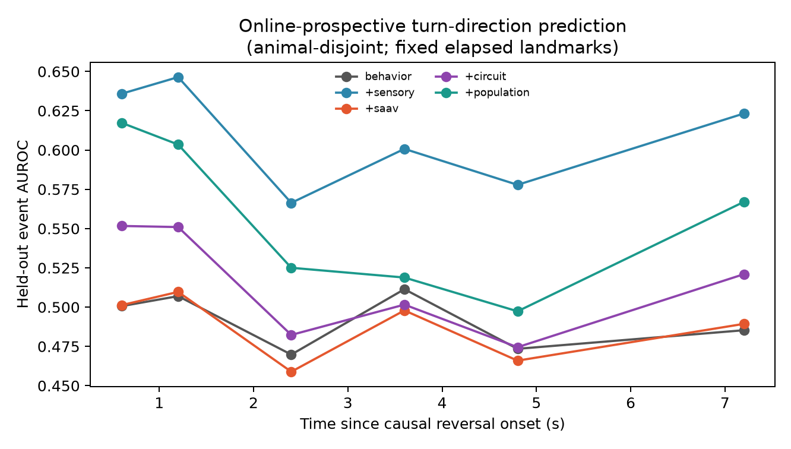

# Phase 5C: genuinely online-prospective turn-direction benchmark

## Question

Can the dorsal/ventral direction of a reversal be predicted **before the reversal
ends**, from information available at a fixed elapsed time after a causally
detected reversal onset, and does SAAV or the compact head-steering circuit add
information beyond behaviour and sensory context?

This is a stronger test than the offline Phase 4 benchmark: no reversal duration,
final direction, future neural frame or future event termination is used to
choose a landmark or build a feature window.

## Causal design

- **Onset:** archival reversal-state rising edge (`reversal_vec` 0→1). A
  velocity-threshold detector (two-frame confirmation, detection at the
  confirmation frame) is implemented as a sensitivity analysis.
- **Landmarks:** fixed elapsed times `τ ∈ {0.6, 1.2, 2.4, 3.6, 4.8, 7.2}` s
  after the detected onset. A sample is included only when
  `onset + τ < reversal_end` and at least 3.6 s of history exists.
- **History:** 12 frames (7.2 s) ending at the prediction frame. No frame after
  the prediction frame enters the model.
- **Label:** sign of the mean orientation-corrected `dv` in the first two frames
  after the annotated reversal offset. Positive is dorsal.
- **Target/risk-set use:** the end and direction are used only after the feature
  window is fixed, to define the label, lead time and risk set. They are not
  used to select the landmark or window.
- **Normalization:** per-channel mean/SD fitted on the training animals only and
  applied to validation/test. No full-recording or test-set z-scoring.
- **Split:** animal-disjoint five-fold. Animals are assigned greedily to balance
  dorsal-event counts; no animal appears in both train and test. The SAAV
  primary cohort uses the same events for every baseline.
- **Class balancing:** training only. Event-balanced sampling for the RNN;
  `class_weight='balanced'` for the logistic baseline. Predictions are shifted
  back to the **training** prevalence; Platt calibration was rejected because it
  was unstable with small inner-validation sets.

## Cohort and risk sets

The primary cohort is the 428 wild-type events with a definite SAAV identity;
it contains 27 animals and 2,510 event×landmark samples (528 dorsal, 1,982
ventral samples). At 0.6 s there are 904 usable wild-type events (170 dorsal,
734 ventral; 50/56 animals). At 7.2 s the risk set shrinks to 854 events
(156 dorsal, 698 ventral) because some reversals have ended. All exclusions and
counts are in `reports/phase5/online_decoding/online_risk_sets.csv` and
`online_exclusions.csv`.

## Baselines

| mode | features at the prediction frame |
|---|---|
| `prior` | training prevalence, no features |
| `behavior` | head curvature, velocity, angular velocity, pumping |
| `behavior_sensory` | behaviour + current odour index and distance from centre |
| `behavior_saav` | behaviour + SAAV |
| `behavior_circuit` | behaviour + SAAV, SMDD, SMBV, SMBD (missing identities imputed after train scaling) |
| `behavior_population` | behaviour + mean/SD across identified neurons, **excluding Kato behaviour-label neurons (AVA, SMD, RIB) and SAAV**; an all-neuron version is retained as a sensitivity check |

Two model classes are compared: a linear logistic model on six summary
statistics per channel, and the architecture-compatible small GRU on the
sequence (last-timestep output). The RNN is trained only on training animals;
inner validation selects the epoch. Four hundred animal-cluster bootstrap
resamples are used for paired deltas.

## Results

Held-out event log loss is the prespecified primary metric. Negative Δ means the
neural model is better than behaviour; positive means worse. AUROC is secondary.

| landmark | prior log loss | behaviour log loss / AUROC | +sensory log loss / AUROC | +SAAV log loss / AUROC | +population log loss / AUROC |
|---:|---:|---:|---:|---:|---:|
| 0.6 s | 0.521 | 0.545 / 0.501 | **0.507 / 0.636** | 0.546 / 0.501 | 0.529 / 0.617 |
| 1.2 s | 0.521 | 0.542 / 0.507 | **0.503 / 0.646** | 0.546 / 0.510 | 0.536 / 0.604 |
| 2.4 s | 0.518 | 0.573 / 0.470 | 0.550 / 0.566 | 0.603 / 0.459 | 0.581 / 0.525 |
| 3.6 s | 0.516 | 0.557 / 0.511 | 0.521 / 0.601 | 0.590 / 0.498 | 0.584 / 0.519 |
| 4.8 s | 0.512 | 0.573 / 0.473 | 0.538 / 0.578 | 0.601 / 0.466 | 0.598 / 0.497 |
| 7.2 s | 0.509 | 0.570 / 0.485 | 0.538 / 0.623 | 0.589 / 0.489 | 0.564 / 0.567 |

Linear-model results. The RNN was at or below the prior on log loss at every
landmark; its best AUROC was 0.536 (behaviour, 4.8 s). SAAV-only RNN and circuit
RNN did not improve.

Paired animal-cluster deltas for the linear model:

| landmark | +SAAV Δ log loss [95% CI] | +population Δ log loss [95% CI] | +population Δ AUROC [95% CI] |
|---:|---|---|---|
| 0.6 s | +0.0017 [−0.0048, +0.0077] | −0.0153 [−0.0540, +0.0321] | **+0.117 [+0.042, +0.191]** |
| 1.2 s | +0.0040 [−0.0013, +0.0092] | −0.0058 [−0.0437, +0.0403] | **+0.097 [+0.032, +0.163]** |
| 2.4 s | +0.0298 [−0.0010, +0.0710] | +0.0079 [−0.0273, +0.0582] | **+0.055 [+0.001, +0.095]** |
| 3.6 s | +0.0327 [−0.0008, +0.0767] | +0.0272 [−0.0106, +0.0829] | +0.007 [−0.047, +0.052] |
| 4.8 s | **+0.0278 [+0.0013, +0.0609]** | +0.0248 [−0.0164, +0.0814] | +0.024 [−0.023, +0.066] |
| 7.2 s | +0.0191 [−0.0032, +0.0431] | −0.0057 [−0.0405, +0.0291] | **+0.082 [+0.018, +0.151]** |

The +population AUROC interval excludes zero at 0.6, 1.2 and 7.2 s and is
marginal at 2.4 s, but the **primary log-loss intervals include zero at every
landmark**. The population model excludes Kato behaviour-label neurons (AVA,
SMD, RIB) and SAAV; an all-neuron sensitivity check gives nearly identical
AUROC increments (0.6 s +0.116, 1.2 s +0.099), so the early signal is not solely
label-neuron or SAAV contamination. SAAV, the compact circuit and the RNN show
no incremental evidence. The population signal is therefore a secondary,
calibration-weak association, not a validated direction code.
Per-animal log-loss differences (population − behaviour, equal animal weights)
are mean −0.030 and 16/24 improved at 0.6 s, −0.017 and 16/24 at 1.2 s, and
−0.009 and 17/24 at 7.2 s; at 3.6–4.8 s the mean changes sign. This
between-animal heterogeneity is why the pooled event-level interval crosses
zero despite a negative mean early. The full table is
`reports/phase5/online_decoding/online_per_animal_deltas.csv`.

The sensory-context model has the best log loss at 0.6–1.2 s; its AUROC gain over
behaviour is +0.135 to +0.139 with CIs above zero, while its log-loss interval
still crosses zero.

Behaviour-only sensitivity across all 904 wild-type events (not the SAAV
subset) is better than the SAAV-cohort behaviour baseline (AUROC 0.61 at 0.6 s,
log loss 0.480; 0.56 at 7.2 s, log loss 0.504). This cohort shift is a warning:
the SAAV-identified subset is not representative of all wild-type events, and
the primary common-cohort comparison is deliberately conservative.

## Interpretation

- **No neural proper-score increment was demonstrated online.** The population
  AUROC effect is secondary and does not survive the prespecified log-loss
  criterion; it persists after excluding Kato behaviour-label neurons and SAAV,
  but may still reflect current sensory/motor state rather than a
  direction-specific neural code.
- **SAAV did not add information at any landmark** (positive Δ log loss at all
  landmarks; the 4.8 s interval excludes zero in the adverse direction).
- **The compact circuit did not add information**; most point estimates were
  adverse.
- **Sensory context is the strongest early predictor** (odor/distance at the
  prediction time), consistent with direction being guided by the animal's
  current sensory/heading state rather than a long neural preview.
- **The online test is not the offline Phase 4 test.** It removes future event
  termination and uses a causal onset, so weaker performance is expected. It
  does not show that SAAV is functionally irrelevant.

## Limitations

The reconstruction has 428 SAAV-cohort events from 27 animals, far fewer than
the published event count. Identified-neuron coverage is incomplete; circuit
missing values are imputed, not experimentally measured. The RNN is an
independent PyTorch implementation, not the official JAX/Equinox code. The
archival reversal state is used as the primary causal onset; an automated
velocity detector is only a sensitivity design. The label still uses the
annotated offset, but only after the prediction time; this is a retrospective
target, not a retrospective feature.

Machine-readable outputs: `reports/phase5/online_decoding/online_metrics.csv`,
`online_deltas.csv`, `online_baselines.csv`, `online_predictions.parquet`,
`online_risk_sets.csv`, `online_config.json`; the all-neuron sensitivity check is
`online_metrics_all_population_sensitivity.csv`.
