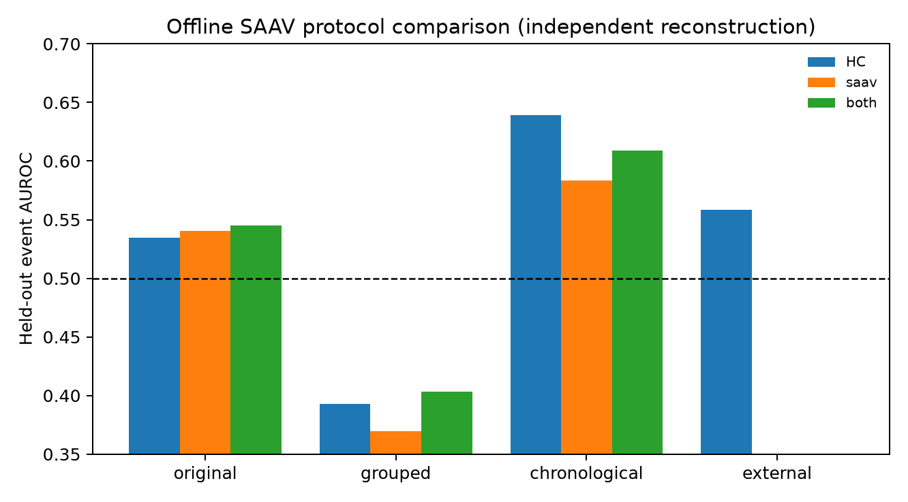

# Phase 5B: protocol comparison and reconstruction

## Status

| claim | status |
|---|---|
| Exact reproduction of Kramer et al. SAAV decoding | `BLOCKED_MISSING_INPUTS` |
| Reconstruction of the method from public raw data | `PARTIAL_REPRODUCTION` |
| Independent animal-disjoint validation | `METHOD_RECONSTRUCTION` |

The four aligned CSVs used by the official code are absent from the public code
and the Dryad archive. The source audit and file hashes are in
[`PHASE5_KRAMER_REPRODUCTION.md`](PHASE5_KRAMER_REPRODUCTION.md). No number below
is presented as the paper's number.

## Exact reference protocol, from source

- Input: 2 channels (SAAV, head curvature); the third `load_data` channel is
  zeros and is not used by `train.py`.
- Event trace: approximately 50 frames; all contiguous 4-frame sections are
  extracted (47 sections for 50 frames), so the effective sample count is
  section-level and highly overlapping within event.
- Model: Equinox `GRUCell(2→3)`, zero hidden state, `lax.scan`, dropout 0.5 on
  every hidden state, LayerNorm(3), Linear(3→1) plus a separate zero bias,
  sigmoid at every timestep; output `(T,1)`.
- Training: 250 epochs, Adam `lr=1e-3`, batch 16, class-balanced event sampling
  with ventral balancing, validation-loss epoch selection.
- Evaluation: 5 outer × 4 inner rotations; reported test accuracy is
  **section/timestep class-balanced accuracy**, not event AUROC and not an
  animal-disjoint event-level proper score.
- Known source-label bug: `lax.select(shuffle, train_ys, train_ys[perm])` aligns
  labels only when `shuffle=False`; the public notebook uses `shuffle=False`.

## Reconstruction

| element | reference | this reconstruction |
|---|---|---|
| input files | four missing FlossieAligned CSVs | raw Dryad HDF5 |
| frame count | ~50 per event | 48 phase-sampled frames |
| alignment | published alignment, unknown details | head-curvature phase, 4 samples/cycle, window ending at last reversal frame |
| normalization | per-recording z-score | per-recording z-score, then train-only rescaling for the classifier |
| SAAV identity | pre-extracted SAAV trace | `SAAV` label from the recording's neuron table |
| events | full published cohort | 250 WT events, 62 dorsal/188 ventral, 26 animals |
| sections | 47/event, all used | all 45 sections/event for architecture-compatible RNN |
| model | JAX/Equinox | independent PyTorch GRU with same architectural contract |
| class balance | event-level, ventral balancing | event-level, train-only |
| primary metric | section balanced accuracy | animal-disjoint event log loss; section accuracy secondary |
| calibration | not reported | train-prior logit shift; Platt rejected as unstable |
| uncertainty | rotations | animal-cluster paired bootstrap |

The reconstruction is an independent implementation. No GPL source file is
copied into the tracked package. JAX/Equinox are not installed; the PyTorch
implementation is not numerically identical.

## Four validation regimes

| regime | split unit | what it tests |
|---|---|---|
| `original` | random event sections, but grouped by event for inference | closest to the official ungrouped section style, with event-level scoring |
| `grouped` | animal-disjoint | principal generalisation claim |
| `chronological` | within-animal time order | prospective within-animal generalisation |
| `external` | held-out cohort | transfer to an unseen cohort |

## Results

Held-out event metrics; log loss is primary. Prior reference is the descriptive
entropy of the held-out prevalence, not a trained model.

| regime | mode | n | prev. | log loss | prior log loss | AUROC | section acc. |
|---|---|---:|---:|---:|---:|---:|---:|
| original | behaviour | 250 | 0.248 | 0.560 | 0.559 | 0.534 | 0.500 |
| original | SAAV | 250 | 0.248 | 0.559 | 0.559 | 0.540 | 0.500 |
| original | behaviour+SAAV | 250 | 0.248 | 0.559 | 0.559 | 0.545 | 0.500 |
| grouped | behaviour | 250 | 0.248 | 0.576 | 0.559 | 0.393 | 0.500 |
| grouped | SAAV | 250 | 0.248 | 0.579 | 0.559 | 0.370 | 0.500 |
| grouped | behaviour+SAAV | 250 | 0.248 | 0.575 | 0.559 | 0.403 | 0.500 |
| chronological | behaviour | 52 | 0.423 | 0.804 | 0.681 | 0.639 | 0.500 |
| chronological | SAAV | 52 | 0.423 | 0.803 | 0.681 | 0.583 | 0.500 |
| chronological | behaviour+SAAV | 52 | 0.423 | 0.802 | 0.681 | 0.609 | 0.500 |
| external | behaviour | 116 | 0.267 | 0.584 | 0.576 | 0.558 | 0.500 |
| external | SAAV | 116 | 0.267 | 0.592 | 0.576 | 0.302 | 0.500 |
| external | behaviour+SAAV | 116 | 0.267 | 0.591 | 0.576 | 0.330 | 0.500 |

Incremental SAAV effect (behaviour+SAAV vs behaviour), animal-cluster bootstrap:

| regime | Δ log loss [95% CI] | Δ AUROC [95% CI] | interpretation |
|---|---|---|---|
| original | −0.0008 [−0.0035, +0.0021] | +0.011 [−0.092, +0.115] | no incremental evidence |
| grouped | −0.0004 [−0.0046, +0.0048] | +0.010 [−0.061, +0.076] | no incremental evidence |
| chronological | −0.0019 [−0.0051, +0.0017] | −0.030 [−0.291, +0.263] | no incremental evidence; 52 events |
| external | +0.0066 [−0.0046, +0.0162] | **−0.229 [−0.373, −0.020]** | adverse transfer |

The `original` regime is the closest reconstruction and has the highest SAAV
AUROC, but its log loss is indistinguishable from the prevalence reference and
its 95% AUROC interval includes zero. No regime shows a positive, properly
scored SAAV increment. The grouped and external point estimates are not evidence
that SAAV is harmful; they are small-sample instability and distribution shift.

Section balanced accuracy is 0.500 in every cell because the train-prior shift
pushes almost all section probabilities below 0.5. This is a **failure to
reproduce the published section-accuracy regime**, not a finding that the paper's
accuracy is wrong. The official code reports section accuracy after 5×4 rotations
with a different calibration/threshold regime; our reconstruction cannot be
compared on that metric.

The event-level animal-cluster bootstrap intervals above are primary. For
transparency, equal-weight per-animal log-loss differences (SAAV − behaviour)
are: original mean −0.0006, median +0.0015, 11/26 animals improved; grouped
+0.0018, −0.0002, 14/26; chronological +0.0003, −0.0024, 14/24; external
+0.0068, +0.0040, 4/13. The grouped principal regime is a coin flip at the
animal level, which reinforces the null. The table is in
`reports/phase5/protocol_comparison/protocol_per_animal_deltas.csv`.

## Why the protocols differ

1. **Missing aligned inputs.** The four CSVs encode the authors' event
   extraction, alignment, SAAV trace and normalization. Without them, exact
   reproduction is blocked.
2. **Metric.** Published section/timestep class-balanced accuracy is not event
   AUROC/log loss and is not animal-disjoint. Overlapping sections inflate
   effective sample size and can make a weak event-level signal look stronger.
3. **Event definition and alignment.** Phase sampling, reversal end, minimum
   duration and SAAV identity all change which frames are compared.
4. **Model/training.** JAX/Equinox vs PyTorch, 250 vs 35 epochs, full vs reduced
   section sampling, and different early stopping can change a 3-unit GRU.
5. **Class balance and calibration.** Ventral balancing and train-prior
   correction change the operating point and proper scores.
6. **Sample size.** 250 events/26 animals is much smaller than the published
   cohort; confidence intervals are correspondingly wide.

## Conclusion

The Phase 4 null result is **not explained away** by the published protocol.
Under an independent reconstruction, SAAV does not add event-level information
in any of the four regimes. The most defensible explanation of the discrepancy
is a combination of missing preprocessing/aligned data, a different evaluation
unit (sections vs events), different alignment/event selection, and low power -
not that either group's analysis is invalid. Exact adjudication requires the
four CSVs and the preprocessing script requested in
[`PHASE5_MISSING_DATA_REQUEST.md`](PHASE5_MISSING_DATA_REQUEST.md).

Machine-readable outputs: `reports/phase5/protocol_comparison/`.
