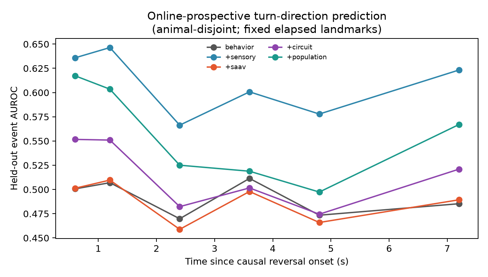

# Phase 5 results: SAAV mechanistic validation

## Status

| item | status |
|---|---|
| Exact Kramer et al. reproduction | `BLOCKED_MISSING_INPUTS` |
| Raw-Dryad method reconstruction | `PARTIAL_REPRODUCTION` |
| Independent animal-disjoint evaluation | `METHOD_RECONSTRUCTION` |
| Virtual intervention | not run; no validated model |

> **MODEL-DEPENDENT VIRTUAL PERTURBATION — NOT CAUSALLY VALIDATED.**

No result in this phase establishes that SAAV or the compact circuit causes
dorsal versus ventral turning.

## 1. What was inspected

- Paper: Kramer et al., *Neural sequences underlying directed turning in C.
  elegans*, *Nature Neuroscience* (2026), DOI
  `10.1038/s41593-026-02257-5`; preprint DOI `10.1101/2024.08.11.607076`.
- Official code: `flavell-lab/SAAV_Decoding`, commit
  `c7e7e18a84cde5dc02df9d63492293b38402eb2c`, GPL-3.0, inspected but not copied
  into the tracked package.
- Data: Dryad `doi:10.5061/dryad.8sf7m0cz2`, dataset `135272`, version `5`,
  version id `433175`, 82 files, 1,455,335,690 bytes, CC0-1.0.

The official code requires four aligned CSVs
(`SAAV_dorsal.csv`, `SAAV_ventral.csv`, `HC_dorsal.csv`, `HC_ventral.csv`) that
are **not** in the repository or Dryad. Exact reproduction is therefore blocked,
not merely difficult. A request for those files is in
[`PHASE5_MISSING_DATA_REQUEST.md`](PHASE5_MISSING_DATA_REQUEST.md).

The public archive contains 80 of 82 files; both missing files are unused
`chxTracks.mat` files. All 80 available files match their recorded SHA-256
digests. The reconstruction uses 73 recordings and 945 wild-type events.

## 2. Reference contract versus reconstruction

The official decoder is a 2-channel Equinox `GRUCell(2→3)` with zero initial
state, dropout 0.5 on every hidden state, LayerNorm, a linear sigmoid output at
every timestep, 250 epochs, Adam `1e-3`, batch 16, 5 outer × 4 inner rotations,
ventral class balancing, and validation-loss epoch selection. Its reported test
metric is **section/timestep class-balanced accuracy**, using all 47 sliding
4-frame sections per 50-frame event, not event-level AUROC and not an
animal-disjoint test.

Our reconstruction uses phase-sampled 48-frame windows ending at the last
reversal frame, 250 events (62 dorsal/188 ventral), 26 animals, a PyTorch
architecture-compatible GRU, animal-disjoint folds, train-only scaling, and
event log loss as the primary metric. Full details and differences are in
[`PHASE5_PROTOCOL_COMPARISON.md`](PHASE5_PROTOCOL_COMPARISON.md) and
[`PHASE5_KRAMER_REPRODUCTION.md`](PHASE5_KRAMER_REPRODUCTION.md).

The reconstruction assumptions were fixed before evaluation. We did not select
the pipeline with the best SAAV result. The closest-to-reference regime
(`original`) did produce the highest SAAV AUROC (0.540), but still without a
proper-score increment.

## 3. Offline results

Held-out event metrics; 250 events/26 animals; prevalence 0.248; prior
log-loss reference 0.559. The prior reference is the descriptive entropy of the
held-out prevalence, not a trained model.

| regime | mode | log loss | AUROC | Δ log loss vs behaviour [95% CI] | Δ AUROC vs behaviour [95% CI] |
|---|---|---:|---:|---|---|
| original | behaviour | 0.560 | 0.534 | - | - |
| original | SAAV | 0.559 | 0.540 | −0.0006 [−0.0029, +0.0018] | +0.006 [−0.081, +0.101] |
| original | both | 0.559 | 0.545 | −0.0008 [−0.0035, +0.0021] | +0.011 [−0.092, +0.115] |
| grouped | behaviour | 0.576 | 0.393 | - | - |
| grouped | SAAV | 0.579 | 0.370 | +0.0030 [−0.0040, +0.0119] | −0.023 [−0.082, +0.029] |
| grouped | both | 0.575 | 0.403 | −0.0004 [−0.0046, +0.0048] | +0.010 [−0.061, +0.076] |
| chronological | behaviour | 0.804 | 0.639 | - | - |
| chronological | SAAV | 0.803 | 0.583 | −0.0014 [−0.0071, +0.0044] | −0.056 [−0.316, +0.247] |
| chronological | both | 0.802 | 0.609 | −0.0019 [−0.0051, +0.0017] | −0.030 [−0.291, +0.263] |
| external | behaviour | 0.584 | 0.558 | - | - |
| external | SAAV | 0.592 | 0.302 | +0.0079 [−0.0046, +0.0191] | **−0.256 [−0.416, −0.037]** |
| external | both | 0.591 | 0.330 | +0.0066 [−0.0046, +0.0162] | **−0.229 [−0.373, −0.020]** |

- No regime shows a positive SAAV increment in log loss. The original-style
  SAAV increment is −0.0006 with a CI crossing zero; grouped is +0.0030. No
  regime produces a positive proper-score effect.
- The external cohort has 116 events/13 animals and shows adverse transfer
  (AUROC 0.33 for both vs 0.56 for behaviour). This is distribution shift and
  small-sample instability, not evidence of harm.
- Chronological evaluation has only 52 events; its high AUROC coexists with poor
  calibration/log loss because prevalence shifts strongly over time.
- Section balanced accuracy is 0.500 in all cells; the reconstruction does not
  reproduce the published section-accuracy operating regime.
- Approximate power with 62 dorsal/188 ventral events is 0.65 for a true AUROC
  of 0.60 and 0.95 for 0.65. The offline test can rule out a large event-level
  effect in this reconstruction, not a modest one.

## 4. Online-prospective results

The online test uses a causal reversal onset and fixed elapsed landmarks
(0.6–7.2 s). A sample is admitted only when the reversal has not ended by the
landmark and 3.6 s of history exists. Features end at the prediction frame; no
future frame, duration or final direction is used to choose the window.
Animal-disjoint five-fold; train-only scaling; 428 SAAV-cohort events/27 animals.

| landmark | prior log loss | behaviour log loss / AUROC | +sensory log loss / AUROC | +SAAV log loss / AUROC | +population log loss / AUROC |
|---:|---:|---:|---:|---:|---:|
| 0.6 s | 0.521 | 0.545 / 0.501 | **0.507 / 0.636** | 0.546 / 0.501 | 0.529 / 0.617 |
| 1.2 s | 0.521 | 0.542 / 0.507 | **0.503 / 0.646** | 0.546 / 0.510 | 0.536 / 0.604 |
| 2.4 s | 0.518 | 0.573 / 0.470 | 0.550 / 0.566 | 0.603 / 0.459 | 0.581 / 0.525 |
| 3.6 s | 0.516 | 0.557 / 0.511 | 0.521 / 0.601 | 0.590 / 0.498 | 0.584 / 0.519 |
| 4.8 s | 0.512 | 0.573 / 0.473 | 0.538 / 0.578 | 0.601 / 0.466 | 0.598 / 0.497 |
| 7.2 s | 0.509 | 0.570 / 0.485 | 0.538 / 0.623 | 0.589 / 0.489 | 0.564 / 0.567 |

- The prior is a strong proper-score baseline because ventral events dominate.
  Behaviour alone is **worse than the prior** on log loss at every landmark.
- Sensory context improves AUROC over behaviour by +0.135 to +0.139 with CIs
  above zero at 0.6/1.2 s, and its log-loss interval vs behaviour is
  [−0.084, +0.002] at 0.6 s (still crossing zero).
- SAAV adds no increment: Δ log loss positive at every landmark; at 4.8 s the
  CI excludes zero in the adverse direction.
- The compact circuit does not add information; most point estimates are
  adverse.
- Population features (excluding Kato behaviour-label neurons and SAAV) raise
  AUROC over behaviour by +0.117 [0.042, 0.191] at 0.6 s, +0.097 [0.032, 0.163]
  at 1.2 s and +0.082 [0.018, 0.151] at 7.2 s, with a marginal +0.055
  [0.001, 0.095] at 2.4 s, but **the primary log-loss deltas include zero at
  every landmark**. An all-neuron sensitivity check gives nearly identical early
  AUROC increments, so the signal is not solely label-neuron or SAAV
  contamination. It remains a secondary, calibration-weak association.
- The architecture-compatible RNN was at or below the prior on log loss at every
  landmark; SAAV-RNN and circuit-RNN did not improve.
- Behaviour-only sensitivity on all 904 wild-type events (not the SAAV subset)
  reaches AUROC 0.610 at 0.6 s and 0.559 at 7.2 s, while behaviour on the
  27-animal SAAV cohort is near chance. This cohort difference must be resolved
  before generalising either way.

## 5. Mechanisms

In the 250-event phase-aligned offline data:

- SAAV: Δ log loss +0.010 [−0.008, +0.029], Δ AUROC −0.006; no increment.
- SMDV: Δ log loss −0.131 [−0.154, −0.107], Δ AUROC +0.313; **61 events/6
  animals**, unstable across animals (dorsal−ventral effect −0.022 [−0.119,
  +0.072], 40% positive). A temporally shifted control gives only −0.024
  [−0.063, +0.024]. This is an exploratory, alignment-sensitive, six-animal
  observation.
- SMBD: Δ log loss +0.038 [+0.011, +0.071], i.e. worse than behaviour.
- Cross-animal stability: SAAV dorsal−ventral −0.019 [−0.091, +0.054], 40%
  positive; no stable SAAV direction code. SAAD and RIV show negative aggregate
  differences in a minority of animals; RMDD has only three animals.
- Multiple comparisons: Holm-corrected within the nine observed channels;
  SMDV survives as an improvement and SMBD survives in the adverse direction.
  Controls are reported separately, not used to rescue a failed observed test.

Encoding is not causation. These are correlational decoding results, and the
"matched ablation" is a model feature removal, not a biological perturbation.
Full table: [`PHASE5_NEURAL_MECHANISMS.md`](PHASE5_NEURAL_MECHANISMS.md).

## 6. Intervention evidence

The public archive has **no trial-level optogenetic or acute cell-specific
stimulation table**. Published RIM/AIB/`tdc-1` findings are group-level or
genotype-level; `tdc-1` is not acute SAAV stimulation. We did not create
pseudo-trials from group averages and did not run virtual intervention
optimisation. See [`PHASE5_INTERVENTION_EVIDENCE.md`](PHASE5_INTERVENTION_EVIDENCE.md).

> **MODEL-DEPENDENT VIRTUAL PERTURBATION — NOT CAUSALLY VALIDATED.**

## 7. Was the Phase 4 discrepancy explained?

**Not fully.** The leading candidate is an evaluation-unit and preprocessing
difference: the published result is section/timestep class-balanced accuracy
after 5×4 rotations, whereas Phase 4 and Phase 5 use event-level animal-aware
scores. The missing aligned CSVs prevent matching the authors' event extraction,
SAAV trace, alignment and normalization. This project cannot say that the
published positive result is wrong; it can say that the positive SAAV result did
not survive an independent animal-disjoint event-level reconstruction.

Other contributors, in order of plausibility:

1. Different event definition/alignment and phase sampling.
2. Section-level versus event-level evaluation, with overlapping sections.
3. Missing preprocessing and SAAV identity details.
4. Model/training differences (JAX/Equinox vs PyTorch, epochs, sampling).
5. Low power (62 dorsal events offline; 89 dorsal online samples).
6. Cohort composition: the SAAV-identified 27 animals behave differently from
   the full 56-animal wild-type set.

## 8. What is and is not causally supported

**Supported observationally:** direction-related information exists in the
population early after onset (AUROC), and sensory context predicts direction
better than head curvature. These are associations in observational data.

**Not supported:** that SAAV causes the turn; that the compact circuit is
necessary; that SMDV is a general direction mechanism; that any manipulation
would change behaviour; that the published paper is incorrect.

## 9. Limitations

- Exact reproduction blocked by four missing CSVs and missing preprocessing.
- 250 offline events/26 animals; 428 online event samples/27 animals.
- Incomplete identified-neuron coverage; circuit missing values imputed.
- Phase alignment and SAAV identity are reconstructed, not author-supplied.
- PyTorch RNN is architecture-compatible, not numerically identical.
- Online onset uses the archival reversal state; the velocity-onset detector is
  a sensitivity design.
- No trial-level intervention data; no causal intervention claim.
- Approximate power: offline 0.65 at AUROC 0.60, online 0.83 at AUROC 0.60.
  Absence of evidence is not evidence of absence.

## 10. Reproducibility

All modelling outputs are under `reports/phase5/`, with per-event predictions,
fold manifests, metrics, bootstrap deltas and configs. Commands are in
[`REPRODUCING.md`](REPRODUCING.md) and `reports/phase5/manifest.json`.
