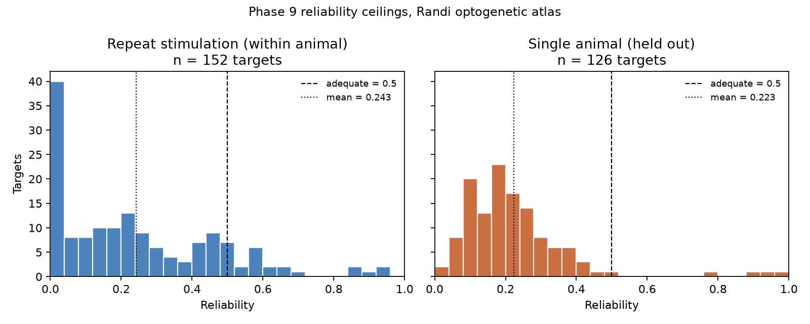

> **Superseded (2026-10-29).** The single-animal numbers in this report
> (0.223 reliability, 0.473 ceiling) and the use of that ceiling to bound the
> pooled Phase 6-8 metrics are corrected in
> [`PHASE10_RESULTS.md`](PHASE10_RESULTS.md) and
> [`CORRECTIONS.md`](CORRECTIONS.md) C6-C7. The corrected single-animal values
> are 0.162 / 0.403; the metric-aligned fold ceiling is 0.833. This file is kept
> for provenance.

# Phase 9 results: the atlas is measurement-limited

**Status:** complete for the reliability audit; design engine deferred.
**Input:** `reports/phase3/randi_trial_table_phase3.csv.gz`
(237,639 trials, 110 animals, 259 targets, 305 neurons; SHA-256 recorded in
`reports/phase9/manifest.json`).
**Code:** `src/neurobranch/benchmark/variance.py`,
`src/neurobranch/benchmark/power.py`, `src/neurobranch/benchmark/claims.py`.
**Artifacts:** `reports/phase9/`.

## Headline

Both reliability ceilings are near 0.5, and the observed single-animal
reliability is near 0.22. The atlas cannot support strong claims about an
individual animal's response profile, and the Phase 8 pair-level advantage is
below the design's own resolution.

| Quantity | Targets | Mean | 95% interval | Median | p90 |
| --- | ---: | ---: | --- | ---: | ---: |
| Repeat reliability (within animal) | 152 | 0.243 | [0.206, 0.279] | 0.192 | — |
| Single-animal reliability (held out) | 126 | 0.223 | [0.196, 0.251] | 0.196 | 0.367 |
| Repeat attenuation ceiling | 152 | 0.493 | — | — | — |
| Single-animal attenuation ceiling | 126 | 0.473 | — | — | — |

Only 13.2% of targets reach repeat reliability 0.5; only 4.0% reach
single-animal reliability 0.5. Intervals are target-level normal approximations
and ignore animal sharing, so they are optimistic about precision.



*If the figure is absent, run `python scripts/phase9_figure.py`; the numbers
above come from `reports/phase9/reliability_by_target.csv` and do not depend on
the figure.*

## What changed relative to Phases 6-8

The Phase 6-8 ceiling was 0.152 from split-half Spearman-Brown. The
variance-corrected single-animal ceiling is 0.473. Consequences:

- Phase 6 CRO pair Spearman 0.0984 was reported as 64% of the ceiling. Against
  the corrected ceiling it is **20.8%**. The model is not near the measurement
  limit; the old ceiling was too low.
- Phase 7 reported normalised scores above 1 because it divided by a truncated
  split-half ceiling. That ratio is not interpretable and is withdrawn.
- Phase 8 H1 pair gate passed (+0.0442, CI [+0.0080, +0.0901]), but the design
  MDE reconstructed from that interval is 0.0587 against a smallest effect of
  interest of 0.020. Under the Phase 9 decision rule the claim is
  **underpowered**, not supported.

The correction runs in both directions: it removes a pessimistic ceiling and a
favourable "64% of ceiling" narrative at the same time. Neither direction was
chosen to favour a model.

## Variance components

Additive two-way moment decomposition of pair-level responses (descriptive, not
REML):

| Component | Estimate |
| --- | ---: |
| Within-event variance | 310.98 |
| Target × responder residual (noise-corrected) | 37.01 |
| Animal main effect | 2.46 |
| Target main effect | 0.53 |
| Sampling variance | 138.16 |

The target × responder residual is large relative to the animal and target main
effects: most of the structured variance is pair-specific, which is consistent
with a response profile that is only weakly shared across animals. The
components do not sum to the total pair-level variance; they are moments for
design calculations.

## Claims ledger

`reports/phase9/claims.json` is the authoritative list. Summary:

| Claim | Status |
| --- | --- |
| Single-animal reliability below 0.5 | supported |
| Repeat reliability below 0.5 | supported |
| Phase 8 pair-level advantage | underpowered |
| Phase 8 trajectory advantage | not supported |
| Phase 8 sequential rollout | not supported |
| Phase 8 EIG vs random | bounded null (±0.01) |
| Phase 7 "64% of ceiling" | not supported (superseded) |

The EIG result is the one place where a null is informative: the interval lies
inside ±0.01, so an effect larger than the declared margin is ruled out at this
sample size.

## Why this is not a failure of the project

A measurement-limited atlas is a real result. It says:

1. The public optogenetic atlas is suitable for population-level questions with
   many animals, not for individual-level prediction.
2. Comparing models on single-animal held-out events has a low ceiling; a
   difference of 0.04 Spearman cannot be interpreted without the MDE.
3. The next investment should be in measurement design (more repetitions per
   animal, longer blocks, better response summaries), not a larger model.

This is a bounded negative result about measurement, not evidence that the
worm's response is mechanistically random.

## Limitations

- Reliability is estimated from the same atlas used for evaluation; a truly
  independent cohort would be stronger evidence.
- The response summary is the mean over a fixed window. Reliability may differ
  for integrals, peak latency or baseline-corrected z-scores.
- The animal facet conditions on targets with at least six animals and three
  responders, which selects better-sampled targets.
- Target-level intervals ignore animal sharing and are descriptive.
- The MDE reconstruction assumes a normal approximation and independent animal
  units; Phase 8 used paired folds, so the MDE is approximate.
- No causal claim is made anywhere in this phase.

## Reproduction

```bash
python scripts/phase9_reliability.py
python scripts/phase9_claims.py --check
python scripts/validate_reports.py --strict
python -m pytest tests/benchmark -q
```

The manifest records the git revision, input hash, parameters and library
versions. Re-running on the same input reproduces the point estimates; the
manifest timestamp changes by design.
