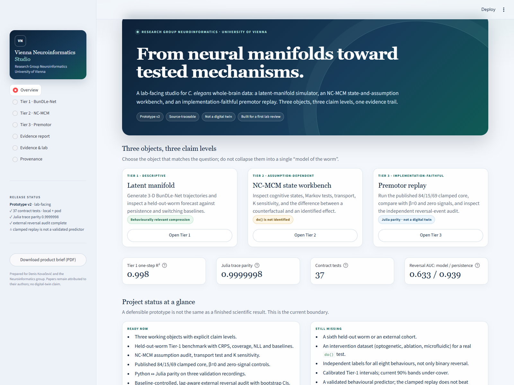
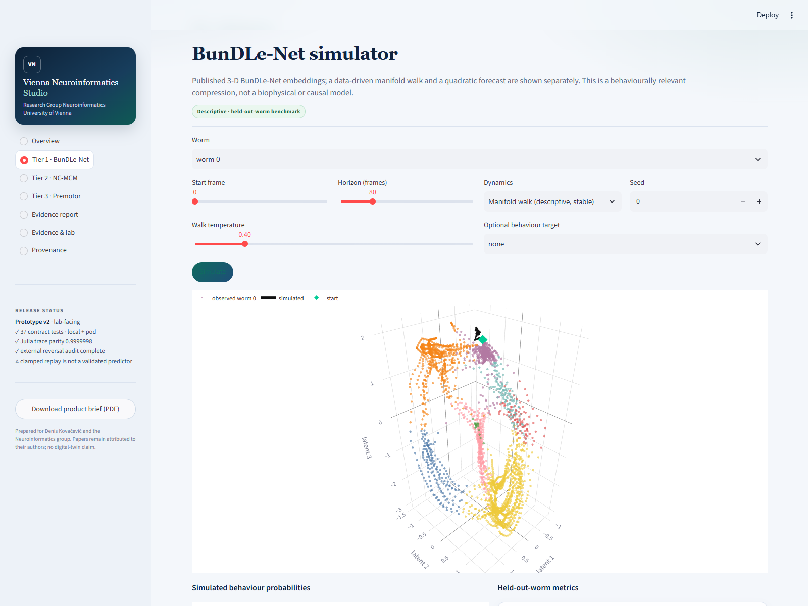
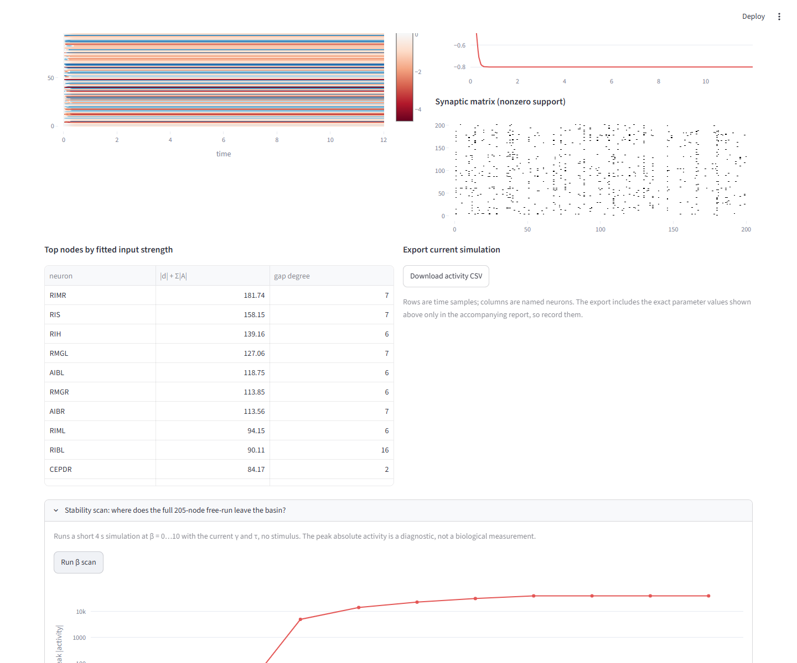

# Vienna Neuroinformatics Workbench

A three-tier, source-traceable prototype for Denis Kovačević and the Research Group
Neuroinformatics, University of Vienna. It starts from the group's **published** work because
there is no internal Denis paper or project to build on.

## Feasibility question

Can the group's existing latent-manifold, causal-state, and premotor modelling artifacts be
assembled into one inspectable workbench that (a) runs real published models, (b) makes each
tier's evidential status explicit, and (c) does not overclaim a mechanistic digital twin?

**Answer: yes for a research prototype; no for a validated whole-brain digital twin.** The
workbench is a scaffold for the group's own next experiments, not a substitute for them.

## What runs

| Tier | Real artifact | What the UI does | Claim level |
|---|---|---|---|
| 1. BunDLe-Net | Five published 3-D consistent embeddings (`3121–3295` frames/worm) | 3-D manifold explorer, held-out-worm metrics, **three-model open-loop benchmark with CRPS, 90% coverage, behaviour NLL and horizon curves**, behaviour probabilities, 32-sample predictive spread | Latent-manifold simulator; **not** mechanistic |
| 2. NC-MCM | Five precomputed NC-MCM models (`x`, 20 cluster solutions, 8 behaviours, 28 pairwise probabilities, Markov p-values) | Choose K, transition matrix, state sequence, behaviour composition, **bootstrap transition intervals, model-based intervention trajectories, cross-worm behaviour JS, assumption audit** | Descriptive causal-state model; **`do()` not identified**; current audit rejects strict Markov/stationarity |
| 3. Premotor | Published 205×205 `A`, drive `d`, **recovered W and 205 neuron names** | **Published clamped core** (15 intrinsic integrated, 69 signals clamped to recording), signal pulses, intrinsic residual, behaviour readout, validation report; separate exploratory 205-node free-run | Clamped replay/sandbox with approximate fidelity; **not** a digital twin |

The UI is one Streamlit app with seven tabs: Overview, three tiers, Evidence report, Evidence & lab,
and Provenance. A Python facade (`ViennaWorkbench`) exposes the same functionality to notebooks.







## Run

```bash
# from the repository root
python scripts/fetch_vienna_artifacts.py        # copies + hashes third-party artifacts
python -m streamlit run src/neurobranch/bundlenet_sim/app.py
```

or, if `streamlit` is on `PATH`:

```bash
streamlit run src/neurobranch/bundlenet_sim/app.py
```

Local URL is printed by Streamlit (default `http://localhost:8501`).

### Data preparation

The third-party artifacts are **not committed** (licenses differ; NC-MCM is GPL-3.0, premotor is
MIT, BunDLe-Net has no explicit license). The fetch script expects the reference repositories at:

```
references/external/nc-mcm/
references/external/Celegans_premotor/
```

and writes:

```
data/processed/bundlenet_sim/bundlenet_consistent_embedding_worm_{0..4}.npz
data/processed/ncmcm/nc_mcm_model_worm_{1..5}.npz
data/processed/premotor/avg_model_weights.jld2
data/processed/premotor/W.npy
data/processed/premotor/neuron_names.txt
data/processed/vienna_artifacts_manifest.json
```

The fetch script also runs `scripts/build_premotor_inputs.py`. That builder reconstructs the
electrical-junction matrix from `White_data_processed/df5.csv` and the 205-name order in
`data/metadata/premotor_neuron_names.txt`, then **rejects** any order for which a non-zero entry
of `A` falls outside the transposed chemical-synapse support. The accepted order has 913/913
non-zero `A` entries inside that support; this check caught several plausible but wrong orders.
The h5py/JLD2 layout is transposed relative to Julia's in-memory matrix, so the loader transposes it
back before use.

Verify an existing copy:

```bash
python scripts/fetch_vienna_artifacts.py --verify-only
```

### Fit Tier 1 from scratch

```bash
PYTHONPATH=src python -m neurobranch.bundlenet_sim.train --alpha 1.0
```

This writes `artifacts/bundlenet_sim/model.npz`, `metrics.json`, and `manifest.json`. The shipped
metrics were produced with this command.

## Measured results (Tier 1)

Leave-one-worm-out, five worms, quadratic latent map + logistic behaviour read-out:

| Metric | Mean | Range / note |
|---|---:|---|
| One-step latent R² | **0.998** | 0.997–0.998 across worms |
| Free-run skill vs constant initial state | **+0.163** | one worm negative (−0.331) |
| Behaviour accuracy on true latent | **96.0%** | 94.4–97.0% |
| Behaviour accuracy on simulated latent | **33.5%** | majority baseline 29.8%; only worm 2 clearly above chance |
| Behaviour macro-F1 on true latent | 0.925 | — |

**Interpretation.** The embeddings are highly predictable one step ahead, but the quadratic
free-run is not a validated generator: it diverges or drifts, and decoded behaviour from simulated
latents is weak. The UI therefore defaults to a **manifold walk** that samples observed
transitions. That walk is stable but is a data-driven Markov sampler, not a mechanistic model.

Per-worm free-run skill: `+0.370, +0.205, −0.331, +0.501, +0.071`. Report the negative fold; do
not reduce this to a single positive number.

### Open-loop benchmark (v2)

`python -m neurobranch.bundlenet_sim.benchmark --horizon 25 --stride 75 --seeds 16` compares three
generative strategies on the same held-out worm and starts. Primary metric is behaviour accuracy
over a 25-frame horizon; secondary metrics are latent MSE, CRPS, marginal 90% ensemble coverage,
behaviour NLL/Brier, and Jensen–Shannon divergence of behaviour distributions/transitions. Starts
are spaced 75 frames apart; 16 seeds are used. The quadratic and switching models receive
training-residual noise so their intervals are not artificially zero-width. This is a descriptive
forecast comparison, not a mechanism test.

| Model | Latent MSE h10 | CRPS h10 | 90% coverage h10 | Behaviour acc h10 | Behaviour NLL h10 | Transition JS h25 |
|---|---:|---:|---:|---:|---:|---:|
| Manifold walk | **0.0445** | **0.0969** | 0.707 | **83.8%** | **0.542** | 0.0361 |
| Quadratic | 0.0539 | 0.1150 | 0.681 | 82.8% | 0.618 | 0.0703 |
| Switching linear + behaviour Markov | 0.0628 | 0.1210 | 0.752 | 66.8% | 0.767 | **0.0544** |

The manifold walk is best on latent MSE, CRPS, behaviour accuracy and NLL at h10, while the
switching model has the best transition JS at h25. All three intervals are **under-covered**
(90% nominal; 68–75% observed), so the ensemble bands must not be presented as calibrated
posterior intervals. **No model is validated for mechanism or for a new worm beyond these five.**
Per-worm values, worst-worm values and 95% normal intervals are in
`reports/vienna_workbench/tier1_benchmark.json`.

### Pod reproduction

The full benchmark was rerun on the H100 pod (`/workspace/vienna-studio`) with a clean extracted
bundle and the pod's Python environment. Means agree with the local run to `< 2e-16`; the file
hash differs only because of tiny floating-point serialisation differences. This is a
reproducibility check, not independent biological validation.

## Tier 2 semantics

The NC-MCM `.npz` schema was mapped from `script_to_generate_ncmcms.jl` and `nilab/src/mcm.jl`:

| Array | Meaning |
|---|---|
| `arr_0` | neuronal activity `x` (T × neurons) |
| `arr_1` | `c` (T × 20): cluster labels for K = 1..20 |
| `arr_2` | behaviour labels, 1-based, ordered as `arr_3` |
| `arr_3` | NC-MCM behaviour names |
| `arr_4` | Markov-chain p-values for K = 1..20 |
| `arr_5` | pairwise logistic probabilities (8 choose 2 = 28 columns) |

The NC-MCM label order differs from the BunDLe-Net demo; the loader maps it explicitly
(`rev2→Reverse-2`, `rev1→Reverse-1`, `slow→Slowing`, `vt→Ventral turn`, `nostate→No state`,
`revsus→Sustained reversal`, `fwd→Forward`, `dt→Dorsal turn`).

**Important:** the precomputed artifact contains no intervention model. The UI's "force state"
panel now propagates `do(S_0=k)` through the fitted transition matrix and shows expected behaviour
over a chosen horizon. This is a **model-based counterfactual under the Markov assumption**, not
an identified causal effect. A real `do(state)` claim needs the NC-MCM assumptions plus
experimental perturbation.

The UI also reports a Dirichlet posterior over transition-matrix rows (200 draws) and
cross-worm Jensen–Shannon divergence of behaviour distributions and behaviour transitions.
Clusters fitted independently in different worms are **not** semantically aligned, so state IDs
and state-transition matrices are never compared across worms.

### Assumption audit

`python -m neurobranch.bundlenet_sim.causal_audit --k 6` writes
`reports/vienna_workbench/tier2_assumption_audit.json` and tests:

| Test | What it asks | Current verdict (K=6, 5 worms) |
|---|---|---|
| Markov order | Does a second-order chain explain more than first-order? | **fail** |
| Stationarity | Are first/second-half transition matrices compatible? | **fail** |
| Behaviour transport | Does held-out-worm behaviour transport beat a split-half baseline? | pass |
| State–behaviour MI | Is state label informative about behaviour beyond chance? | pass |
| K sensitivity | How much does the 20-step behaviour distribution move across K=2..20? | pass |

The two failures are the important result: the precomputed NC-MCM states are descriptive, and a
strict `do(state)` reading is not supported by the data at this K. The audit uses Monte-Carlo
p-values and explicit `insufficient_data` verdicts for sparse rows; it is not a causal
identification proof.

## Tier 3 semantics

The ODE and default parameters follow `functions/functions_simulation.jl` and
`code/simulations.ipynb`:

```
du_j/dt = (1/τ) [ a(u_j−fp1)(u_j−fp2)(u_j−fp3) + d_j
                  + γ Σ_i A[j,i] ReLU(u_i)
                  + β (W u − rowsum(W) ⊙ u)_j ]
a=−2, fp1=−0.8, fp2=0.1, fp3=1.0, γ=1.4, β=10, τ=0.2
```

`A` and `d` are the published fitted values. We recover `W` and the 205-name order from the
release's own connectome table; the accepted order has all 913 non-zero `A` entries inside the
transposed chemical-synapse support. This removes the earlier anonymous-node limitation.

**The paper's configuration is implemented and checked against the authors' Julia code.** The
canonical recording `2023-01-23-15` maps to the published **84 core / 15 intrinsic / 69 signal**
split. The 15 intrinsic neurons are integrated; the 69 signals are linearly interpolated from the
recording and clamped. Signal pulses can be added to any clamped neuron. The other two validation
recordings have measured cores of 85 and 86 neurons and are reported with their actual counts; only
the canonical recording has the exact 84/15/69 split. Missing neurons are filled with the release's
documented donor rules; no generic nearest-neighbour fill is used.

The Python port was compared with a fresh Julia 1.11.2 run of the authors' notebook cells on
`2023-01-23-15`:

| Check | Result |
|---|---|
| Intrinsic-trace Pearson r, mean / minimum over 15 neurons | **0.99999972 / 0.99999954** |
| Maximum absolute Python−Julia trace difference | **0.0133** (range of activity ≈ 3.34) |
| Julia / Python peak |u| | 3.3364 / 3.3369 |
| Canonical behaviour-state agreement / distribution JS | **60.3% / 0.0011** |
| Three-recording mean agreement / mean JS | **58.3% / 0.0113** |

The comparison caught three port defects that a unit test had not: labels were shifted by one
relative to Julia's 1-based indices, smoothing removed four edge frames instead of two, and the
gap-junction term had both a transposed `A` and the opposite sign. The corrected port is an
implementation-faithful replay. It is **not** a validated digital twin: 40–42% of canonical
behaviour frames still disagree, and agreement is not causal identification.

`python scripts/build_tier3_validation.py` writes
`reports/vienna_workbench/tier3_clamped_validation.json` for the canonical and two additional
recordings, with β=0 and zero-signal controls for the canonical case. The controls move the result
substantially (β=0: 38.3% agreement, JS 0.137; zero signals: 49.6% agreement, JS 0.218), so the
trace is not a trivial constant. The UI shows the intrinsic residual and the behaviour readout
rather than hiding the mismatch. This is a replay/sandbox, **not** a validated digital twin.

The separate 205-node free-run remains exploratory. At `β=10` it leaves the stable regime; the
sandbox defaults to `β=0` and warns when `|activity| > 20`. The UI still exposes top nodes by
fitted input strength, gap degree, named stimulation/ablation, CSV export, and a **β stability
scan** that integrates 11 short runs from β=0 to β=10 and plots peak absolute activity on a log
scale. The scan is a numerical diagnostic, not a biological claim.



## API

```python
from neurobranch.bundlenet_sim.workbench import ViennaWorkbench

wb = ViennaWorkbench()
sim, proba = wb.tier1_simulate(worm_id=0, start=0, horizon=80, mode="manifold_walk")
sim2, proba2 = wb.tier1_simulate(worm_id=0, start=0, horizon=80, mode="switching")
model = wb.ncmcm(0)
P = model.transition_matrix(k=6)
traj = model.intervention_horizon(k=6, start_state=1, horizon=20)
boot = model.bootstrap_transition(k=6, n_boot=200)
bench = wb.tier1_benchmark()
ensemble = wb.tier1_ensemble(worm_id=0, start=0, horizon=80, seeds=32)
audit = wb.tier2_audit(k=6)
clamped = wb.tier3_clamped("2023-01-23-15", ClampedParameters(beta=10.0))
t, y = wb.tier3_simulate(PremotorParameters(duration=12.0, beta=0.0))
```

## Files

| Path | Role |
|---|---|
| `src/neurobranch/bundlenet_sim/dataset.py` | load five consistent embeddings |
| `.../dynamics.py` | quadratic ridge dynamics + logistic read-out |
| `.../switching.py` | behaviour-conditioned linear dynamics + Markov behaviour chain |
| `.../evaluate.py` | leave-one-worm-out metrics |
| `.../benchmark.py` | three-model open-loop benchmark v2 (CRPS, coverage, NLL, horizon curve) |
| `.../manifold_walk.py` | stable observed-transition sampler + ensemble rollout |
| `.../ncmcm.py` | NC-MCM schema, transitions, bootstrap, counterfactual propagation |
| `.../causal_audit.py` | Markov order, stationarity, transport, MI, K sensitivity |
| `.../recording.py` | Atanas JSON loader, published preprocessing, 15/69 split |
| `.../clamped.py` | published clamped-core ODE + controls + metrics |
| `.../premotor.py` | JLD2 loader + recovered W/names + 205-node sandbox |
| `.../workbench.py` | unified facade |
| `.../app.py` | seven-tab Streamlit product UI |
| `.../persistence.py` | NPZ model persistence (no pickle) |
| `.../train.py` | Tier 1 CLI |
| `scripts/fetch_vienna_artifacts.py` | copy + SHA-256 manifest + premotor builder |
| `scripts/build_premotor_inputs.py` | recover W/names; verify A support |
| `scripts/build_tier3_validation.py` | clamped-core validation report |
| `scripts/reference/run_julia_reference.jl` | authors' notebook cells, standalone Julia reference |
| `scripts/compare_tier3_reference.py` | Python↔Julia comparison + input hashes |
| `tests/test_bundlenet_clamped.py` | clamped-core contract tests |
| `tests/test_causal_audit.py` | synthetic assumption-audit tests |
| `tests/test_bundlenet_workbench.py` | Tier-1/Tier-2/Tier-3 contract tests |

## Limitations and next decisions

1. **No validated generative simulator.** The manifold walk wins the open-loop benchmark, but it
   samples observed transitions; it is not a mechanistic generator and does not extrapolate.
   All ensemble intervals under-cover their nominal level.
2. **No causal identification.** NC-MCM states are fitted descriptions; the current audit rejects
   strict first-order Markov and stationarity. The intervention panel is explicitly a Markov
   counterfactual until an intervention dataset is analysed.
3. **Premotor clamped mode is implementation-faithful, not a digital twin.** The canonical
   recording has the published 84/15/69 split, and the Python port matches a fresh Julia reference
   run to r=0.9999997 with max |Δ|=0.013. That validates the port, not the biology: 40–42% of
   canonical behaviour frames still disagree, and `W`/names are independently recovered. Do not
   describe it as a validated digital twin.
4. **Preprint status.** BunDLe-Net is a bioRxiv `posted-content` record; do not cite it as a
   peer-reviewed journal article.
5. **Five worms only.** Worm-level splits are the right unit, but n=5 limits generalization claims.

Recommended next experiment: use the now-matched clamped replay as a null/implementation control,
then obtain an experimental perturbation dataset for NC-MCM and pre-register a held-out-worm
comparison of (a) manifold walk, (b) NC-MCM state model, and (c) clamped premotor ODE. A useful
intervention test must change a clamped signal and compare the predicted intrinsic response with
an independent recording; the current pulse panel is still a simulation, not a perturbation
experiment.

## Sources

- Kumar, Gilra, Meunier, Grosse-Wentrup. *BunDLe-Net: Learning minimal neural manifolds that
  represent only behaviourally relevant dynamics.* bioRxiv 2023.
  https://doi.org/10.1101/2023.08.08.551978 (Crossref type: `posted-content`)
- Grosse-Wentrup, Kumar, Meunier, Zimmer. *Neuro-cognitive multilevel causal modeling.*
  PLoS Comput Biol 2024. https://doi.org/10.1371/journal.pcbi.1012674 (PMID 39680605)
- Morrison, Young. *A data-driven biology-based network model reproduces C. elegans premotor
  neural dynamics.* PLoS Comput Biol 2025. https://doi.org/10.1371/journal.pcbi.1013818
  (PMID 41460929; PMC12768384)
