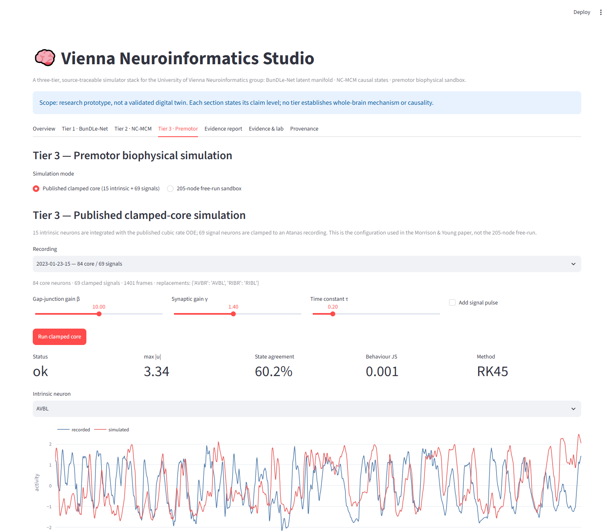

# Vienna Neuroinformatics Workbench

A three-tier, source-traceable prototype for Denis Kovačević and the Research Group
Neuroinformatics, University of Vienna. It starts from the group's **published** work because
there is no internal Denis paper or project to build on.

## Feasibility question

Can the group's existing latent-manifold, causal-state, and premotor modelling artifacts be
assembled into one inspectable workbench that (a) runs real published models, (b) makes each
tier's evidential status explicit, and (c) does not overclaim a mechanistic digital twin?

**Answer: yes for a research prototype; no for a validated whole-brain digital twin.** The
workbench is a scaffold for the group's own next experiments, not a substitute for them.

## What runs

| Tier | Real artifact | What the UI does | Claim level |
|---|---|---|---|
| 1. BunDLe-Net | Five published 3-D consistent embeddings (`3121–3295` frames/worm) | 3-D manifold explorer, held-out-worm metrics, **three-model open-loop benchmark** (manifold walk, switching linear, quadratic), behaviour probabilities | Latent-manifold simulator; **not** mechanistic |
| 2. NC-MCM | Five precomputed NC-MCM models (`x`, 20 cluster solutions, 8 behaviours, 28 pairwise probabilities, Markov p-values) | Choose K, transition matrix, state sequence, behaviour composition, **bootstrap transition intervals, model-based intervention trajectories, cross-worm behaviour JS** | Descriptive causal-state model; **`do()` not identified** |
| 3. Premotor | Published 205×205 `A`, drive `d`, **recovered W and 205 neuron names** | Integrate the cubic rate ODE, stimulate/ablate named neurons, inspect population activity, export CSV | Biophysical sandbox; full 205-node free-run is exploratory; the paper's **clamped-signal** mode is not implemented |

The UI is one Streamlit app with six tabs: Overview, three tiers, Evidence report, and Provenance.
A Python facade (`ViennaWorkbench`) exposes the same functionality to notebooks.




## Run

```bash
# from the repository root
python scripts/fetch_vienna_artifacts.py        # copies + hashes third-party artifacts
python -m streamlit run src/neurobranch/bundlenet_sim/app.py
```

or, if `streamlit` is on `PATH`:

```bash
streamlit run src/neurobranch/bundlenet_sim/app.py
```

Local URL is printed by Streamlit (default `http://localhost:8501`).

### Data preparation

The third-party artifacts are **not committed** (licenses differ; NC-MCM is GPL-3.0, premotor is
MIT, BunDLe-Net has no explicit license). The fetch script expects the reference repositories at:

```
references/external/nc-mcm/
references/external/Celegans_premotor/
```

and writes:

```
data/processed/bundlenet_sim/bundlenet_consistent_embedding_worm_{0..4}.npz
data/processed/ncmcm/nc_mcm_model_worm_{1..5}.npz
data/processed/premotor/avg_model_weights.jld2
data/processed/premotor/W.npy
data/processed/premotor/neuron_names.txt
data/processed/vienna_artifacts_manifest.json
```

The fetch script also runs `scripts/build_premotor_inputs.py`. That builder reconstructs the
electrical-junction matrix from `White_data_processed/df5.csv` and the 205-name order in
`data/metadata/premotor_neuron_names.txt`, then **rejects** any order for which a non-zero entry
of `A` falls outside the chemical-synapse support. The accepted order has 913/913 non-zero `A`
entries inside that support; this check caught several plausible but wrong orders.

Verify an existing copy:

```bash
python scripts/fetch_vienna_artifacts.py --verify-only
```

### Fit Tier 1 from scratch

```bash
PYTHONPATH=src python -m neurobranch.bundlenet_sim.train --alpha 1.0
```

This writes `artifacts/bundlenet_sim/model.npz`, `metrics.json`, and `manifest.json`. The shipped
metrics were produced with this command.

## Measured results (Tier 1)

Leave-one-worm-out, five worms, quadratic latent map + logistic behaviour read-out:

| Metric | Mean | Range / note |
|---|---:|---|
| One-step latent R² | **0.998** | 0.997–0.998 across worms |
| Free-run skill vs constant initial state | **+0.163** | one worm negative (−0.331) |
| Behaviour accuracy on true latent | **96.0%** | 94.4–97.0% |
| Behaviour accuracy on simulated latent | **33.5%** | majority baseline 29.8%; only worm 2 clearly above chance |
| Behaviour macro-F1 on true latent | 0.925 | — |

**Interpretation.** The embeddings are highly predictable one step ahead, but the quadratic
free-run is not a validated generator: it diverges or drifts, and decoded behaviour from simulated
latents is weak. The UI therefore defaults to a **manifold walk** that samples observed
transitions. That walk is stable but is a data-driven Markov sampler, not a mechanistic model.

Per-worm free-run skill: `+0.370, +0.205, −0.331, +0.501, +0.071`. Report the negative fold; do
not reduce this to a single positive number.

### Open-loop benchmark (new)

`python -m neurobranch.bundlenet_sim.benchmark --horizon 25 --stride 75 --seeds 4` compares three
generative strategies on the same held-out worm and starts. Primary metric is behaviour accuracy
over a 25-frame horizon; secondary metrics are latent MSE and Jensen–Shannon divergence of
behaviour distributions/transitions. Starts are spaced 75 frames apart; four seeds are used for
the stochastic models. This is a descriptive forecast comparison, not a mechanism test.

| Model | Latent MSE h10 | Behaviour acc h10 | Behaviour acc h25 | Transition JS h25 |
|---|---:|---:|---:|---:|
| Manifold walk | **0.0517** | **83.2%** | **70.8%** | 0.0417 |
| Quadratic | 0.0532 | 83.9% | 64.9% | 0.0670 |
| Switching linear + behaviour Markov | 0.0666 | 71.9% | 50.3% | **0.0379** |

The manifold walk is best at the longer horizon and on latent MSE, while the quadratic map is
slightly better at h10 and collapses by h25. The switching model preserves transition statistics
but over-regularises behaviour and loses accuracy. **No model is validated for mechanism or for a
new worm beyond these five.** Per-worm values and 95% normal intervals are in
`reports/vienna_workbench/tier1_benchmark.json`.

### Pod reproduction

The full benchmark was rerun on the H100 pod (`/workspace/vienna-studio`) with a clean extracted
bundle and the pod's Python environment. Means agree with the local run to `< 2e-16`; the file
hash differs only because of tiny floating-point serialisation differences. This is a
reproducibility check, not independent biological validation.

## Tier 2 semantics

The NC-MCM `.npz` schema was mapped from `script_to_generate_ncmcms.jl` and `nilab/src/mcm.jl`:

| Array | Meaning |
|---|---|
| `arr_0` | neuronal activity `x` (T × neurons) |
| `arr_1` | `c` (T × 20): cluster labels for K = 1..20 |
| `arr_2` | behaviour labels, 1-based, ordered as `arr_3` |
| `arr_3` | NC-MCM behaviour names |
| `arr_4` | Markov-chain p-values for K = 1..20 |
| `arr_5` | pairwise logistic probabilities (8 choose 2 = 28 columns) |

The NC-MCM label order differs from the BunDLe-Net demo; the loader maps it explicitly
(`rev2→Reverse-2`, `rev1→Reverse-1`, `slow→Slowing`, `vt→Ventral turn`, `nostate→No state`,
`revsus→Sustained reversal`, `fwd→Forward`, `dt→Dorsal turn`).

**Important:** the precomputed artifact contains no intervention model. The UI's "force state"
panel now propagates `do(S_0=k)` through the fitted transition matrix and shows expected behaviour
over a chosen horizon. This is a **model-based counterfactual under the Markov assumption**, not
an identified causal effect. A real `do(state)` claim needs the NC-MCM assumptions plus
experimental perturbation.

The UI also reports a Dirichlet posterior over transition-matrix rows (200 draws) and
cross-worm Jensen–Shannon divergence of behaviour distributions and behaviour transitions.
Clusters fitted independently in different worms are **not** semantically aligned, so state IDs
and state-transition matrices are never compared across worms.

## Tier 3 semantics

The ODE and default parameters follow `functions/functions_simulation.jl` and
`code/simulations.ipynb`:

```
du_j/dt = (1/τ) [ a(u_j−fp1)(u_j−fp2)(u_j−fp3) + d_j
                  + γ Σ_i A[j,i] ReLU(u_i)
                  + β Σ_i W[j,i](u_i−u_j) ]
a=−2, fp1=−0.8, fp2=0.1, fp3=1.0, γ=1.4, β=10, τ=0.2
```

`A` and `d` are the published fitted values. We recover `W` and the 205-name order from the
release's own connectome table; the accepted order has all 913 non-zero `A` entries inside the
chemical-synapse support. This removes the earlier anonymous-node limitation.

**However, this is not the paper's simulation.** The published `simulations.ipynb` simulates only
the ~15 intrinsic neurons and **clamps 69 signal neurons** to recorded activity. The current page
runs all 205 nodes freely. At the published `β=10` that free-run leaves the stable regime; the UI
therefore defaults to `β=0` and warns when `|activity| > 20`. The clamped-signal mode is the
highest-value next implementation, not a completed feature.

The UI also exposes top nodes by fitted input strength, gap degree, named stimulation/ablation,
CSV export, and a **β stability scan** that integrates 11 short runs from β=0 to β=10 and plots peak
absolute activity on a log scale. The scan is a numerical diagnostic, not a biological claim.


## API

```python
from neurobranch.bundlenet_sim.workbench import ViennaWorkbench

wb = ViennaWorkbench()
sim, proba = wb.tier1_simulate(worm_id=0, start=0, horizon=80, mode="manifold_walk")
sim2, proba2 = wb.tier1_simulate(worm_id=0, start=0, horizon=80, mode="switching")
model = wb.ncmcm(0)
P = model.transition_matrix(k=6)
traj = model.intervention_horizon(k=6, start_state=1, horizon=20)
boot = model.bootstrap_transition(k=6, n_boot=200)
bench = wb.tier1_benchmark()
t, y = wb.tier3_simulate(PremotorParameters(duration=12.0, beta=0.0))
```

## Files

| Path | Role |
|---|---|
| `src/neurobranch/bundlenet_sim/dataset.py` | load five consistent embeddings |
| `.../dynamics.py` | quadratic ridge dynamics + logistic read-out |
| `.../switching.py` | behaviour-conditioned linear dynamics + Markov behaviour chain |
| `.../evaluate.py` | leave-one-worm-out metrics |
| `.../benchmark.py` | three-model open-loop benchmark + JSON CLI |
| `.../manifold_walk.py` | stable observed-transition sampler |
| `.../ncmcm.py` | NC-MCM schema, transitions, bootstrap, counterfactual propagation |
| `.../premotor.py` | JLD2 loader + recovered W/names + ODE sandbox |
| `.../workbench.py` | unified facade |
| `.../app.py` | six-tab Streamlit product UI |
| `.../persistence.py` | NPZ model persistence (no pickle) |
| `.../train.py` | Tier 1 CLI |
| `scripts/fetch_vienna_artifacts.py` | copy + SHA-256 manifest + premotor builder |
| `scripts/build_premotor_inputs.py` | recover W/names; verify A support |
| `tests/test_bundlenet_workbench.py` | seven contract tests |

## Limitations and next decisions

1. **No validated generative simulator.** The manifold walk wins the open-loop benchmark, but it
   samples observed transitions; it is not a mechanistic generator and does not extrapolate.
2. **No causal identification.** NC-MCM states are fitted descriptions. The intervention panel is
   explicitly a Markov counterfactual until an intervention dataset is analysed.
3. **Premotor free-run is not the published simulation.** W/names are recovered, but the paper's
   clamped-signal mode (15 intrinsic + 69 clamped) is not implemented. Do not describe the 205-node
   free-run as the paper's model or a digital twin.
4. **Preprint status.** BunDLe-Net is a bioRxiv `posted-content` record; do not cite it as a
   peer-reviewed journal article.
5. **Five worms only.** Worm-level splits are the right unit, but n=5 limits generalization claims.

Recommended next experiment: implement the premotor clamped-signal mode from one Atanas recording
and compare simulated versus observed intrinsic traces before any intervention claim. In parallel,
obtain an experimental perturbation dataset for NC-MCM and pre-register a held-out-worm comparison
of (a) manifold walk, (b) NC-MCM state model, and (c) premotor ODE.

## Sources

- Kumar, Gilra, Meunier, Grosse-Wentrup. *BunDLe-Net: Learning minimal neural manifolds that
  represent only behaviourally relevant dynamics.* bioRxiv 2023.
  https://doi.org/10.1101/2023.08.08.551978 (Crossref type: `posted-content`)
- Grosse-Wentrup, Kumar, Meunier, Zimmer. *Neuro-cognitive multilevel causal modeling.*
  PLoS Comput Biol 2024. https://doi.org/10.1371/journal.pcbi.1012674 (PMID 39680605)
- Morrison, Young. *A data-driven biology-based network model reproduces C. elegans premotor
  neural dynamics.* PLoS Comput Biol 2025. https://doi.org/10.1371/journal.pcbi.1013818
  (PMID 41460929; PMC12768384)
