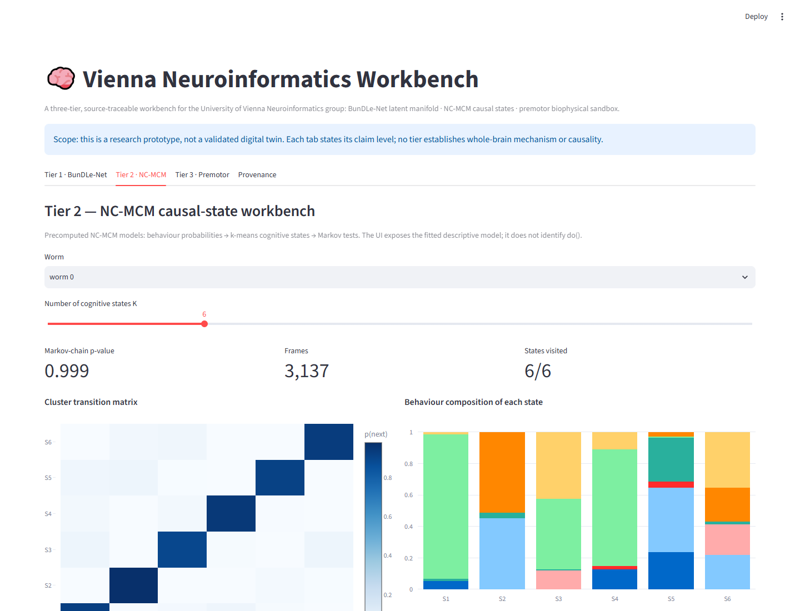

# Vienna Neuroinformatics Workbench

A three-tier, source-traceable prototype for Denis Kovačević and the Research Group
Neuroinformatics, University of Vienna. It starts from the group's **published** work because
there is no internal Denis paper or project to build on.

## Feasibility question

Can the group's existing latent-manifold, causal-state, and premotor modelling artifacts be
assembled into one inspectable workbench that (a) runs real published models, (b) makes each
tier's evidential status explicit, and (c) does not overclaim a mechanistic digital twin?

**Answer: yes for a research prototype; no for a validated whole-brain digital twin.** The
workbench is a scaffold for the group's own next experiments, not a substitute for them.

## What runs

| Tier | Real artifact | What the UI does | Claim level |
|---|---|---|---|
| 1. BunDLe-Net | Five published 3-D consistent embeddings (`3121–3295` frames/worm) | 3-D manifold explorer, held-out-worm metrics, stable manifold walk and unstable quadratic forecast, behaviour probabilities | Latent-manifold simulator; **not** mechanistic |
| 2. NC-MCM | Five precomputed NC-MCM models (`x`, 20 cluster solutions, 8 behaviours, 28 pairwise probabilities, Markov p-values) | Choose K, inspect transition matrix, state sequence, behaviour composition, observational `do(state)` read-out | Descriptive causal-state model; **`do()` not identified** |
| 3. Premotor | Published 205×205 fitted chemical synaptic matrix `A` and drive `d` | Integrate the published cubic rate ODE, stimulate/ablate nodes, inspect population activity | Biophysical sandbox; gap-junction matrix `W` and neuron names are **absent from the export** |

The UI is one Streamlit app with four tabs (three tiers + provenance). A Python facade
(`ViennaWorkbench`) exposes the same functionality to notebooks.





## Run

```bash
# from the repository root
python scripts/fetch_vienna_artifacts.py        # copies + hashes third-party artifacts
python -m streamlit run src/neurobranch/bundlenet_sim/app.py
```

or, if `streamlit` is on `PATH`:

```bash
streamlit run src/neurobranch/bundlenet_sim/app.py
```

Local URL is printed by Streamlit (default `http://localhost:8501`).

### Data preparation

The third-party artifacts are **not committed** (licenses differ; NC-MCM is GPL-3.0, premotor is
MIT, BunDLe-Net has no explicit license). The fetch script expects the reference repositories at:

```
references/external/nc-mcm/
references/external/Celegans_premotor/
```

and writes:

```
data/processed/bundlenet_sim/bundlenet_consistent_embedding_worm_{0..4}.npz
data/processed/ncmcm/nc_mcm_model_worm_{1..5}.npz
data/processed/premotor/avg_model_weights.jld2
data/processed/vienna_artifacts_manifest.json
```

Verify an existing copy:

```bash
python scripts/fetch_vienna_artifacts.py --verify-only
```

### Fit Tier 1 from scratch

```bash
PYTHONPATH=src python -m neurobranch.bundlenet_sim.train --alpha 1.0
```

This writes `artifacts/bundlenet_sim/model.npz`, `metrics.json`, and `manifest.json`. The shipped
metrics were produced with this command.

## Measured results (Tier 1)

Leave-one-worm-out, five worms, quadratic latent map + logistic behaviour read-out:

| Metric | Mean | Range / note |
|---|---:|---|
| One-step latent R² | **0.998** | 0.997–0.998 across worms |
| Free-run skill vs constant initial state | **+0.163** | one worm negative (−0.331) |
| Behaviour accuracy on true latent | **96.0%** | 94.4–97.0% |
| Behaviour accuracy on simulated latent | **33.5%** | majority baseline 29.8%; only worm 2 clearly above chance |
| Behaviour macro-F1 on true latent | 0.925 | — |

**Interpretation.** The embeddings are highly predictable one step ahead, but the quadratic
free-run is not a validated generator: it diverges or drifts, and decoded behaviour from simulated
latents is weak. The UI therefore defaults to a **manifold walk** that samples observed
transitions. That walk is stable but is a data-driven Markov sampler, not a mechanistic model.

Per-worm free-run skill: `+0.370, +0.205, −0.331, +0.501, +0.071`. Report the negative fold; do
not reduce this to a single positive number.

## Tier 2 semantics

The NC-MCM `.npz` schema was mapped from `script_to_generate_ncmcms.jl` and `nilab/src/mcm.jl`:

| Array | Meaning |
|---|---|
| `arr_0` | neuronal activity `x` (T × neurons) |
| `arr_1` | `c` (T × 20): cluster labels for K = 1..20 |
| `arr_2` | behaviour labels, 1-based, ordered as `arr_3` |
| `arr_3` | NC-MCM behaviour names |
| `arr_4` | Markov-chain p-values for K = 1..20 |
| `arr_5` | pairwise logistic probabilities (8 choose 2 = 28 columns) |

The NC-MCM label order differs from the BunDLe-Net demo; the loader maps it explicitly
(`rev2→Reverse-2`, `rev1→Reverse-1`, `slow→Slowing`, `vt→Ventral turn`, `nostate→No state`,
`revsus→Sustained reversal`, `fwd→Forward`, `dt→Dorsal turn`).

**Important:** the precomputed artifact contains no intervention model. The UI's "force state"
panel is an **observational conditional read-out**, not an identified causal effect. A real
`do(state)` claim needs the NC-MCM assumptions plus experimental perturbation.

## Tier 3 semantics

The ODE and default parameters follow `functions/functions_simulation.jl` and
`code/simulations.ipynb`:

```
du_j/dt = (1/τ) [ a(u_j−fp1)(u_j−fp2)(u_j−fp3) + d_j
                  + γ Σ_i A[j,i] ReLU(u_i)
                  + β Σ_i W[j,i](u_i−u_j) ]
a=−2, fp1=−0.8, fp2=0.1, fp3=1.0, γ=1.4, β=10, τ=0.2
```

`A` and `d` are the published fitted values. The public export does **not** contain `W`
(gap junctions) or the neuron-name order, so `W=0` and nodes are indexed `0..204`. This is why
the tier is labelled a sandbox, not the paper's full model and not a digital twin.

## API

```python
from neurobranch.bundlenet_sim.workbench import ViennaWorkbench

wb = ViennaWorkbench()
sim, proba = wb.tier1_simulate(worm_id=0, start=0, horizon=80, mode="manifold_walk")
model = wb.ncmcm(0)
P = model.transition_matrix(k=6)
t, y = wb.tier3_simulate(PremotorParameters(duration=12.0))
```

## Files

| Path | Role |
|---|---|
| `src/neurobranch/bundlenet_sim/dataset.py` | load five consistent embeddings |
| `.../dynamics.py` | quadratic ridge dynamics + logistic read-out |
| `.../evaluate.py` | leave-one-worm-out metrics |
| `.../manifold_walk.py` | stable observed-transition sampler |
| `.../ncmcm.py` | NC-MCM schema, transitions, p-values |
| `.../premotor.py` | JLD2 loader + ODE sandbox |
| `.../workbench.py` | unified facade |
| `.../app.py` | Streamlit UI |
| `.../persistence.py` | NPZ model persistence (no pickle) |
| `.../train.py` | Tier 1 CLI |
| `scripts/fetch_vienna_artifacts.py` | copy + SHA-256 manifest |
| `tests/test_bundlenet_workbench.py` | contract tests |

## Limitations and next decisions

1. **No validated generative simulator.** Free-run behaviour decoding is near majority; do not
   present rollouts as predictions of a new worm.
2. **No causal identification.** NC-MCM states are fitted descriptions. The `do()` panel must stay
   labelled observational until an intervention dataset is analysed.
3. **Incomplete premotor export.** Recover `W` and the neuron order from the authors' Julia
   environment before calling Tier 3 the published model. Until then it is chemical-only and
   anonymous.
4. **Preprint status.** BunDLe-Net is a bioRxiv `posted-content` record; do not cite it as a
   peer-reviewed journal article.
5. **Five worms only.** Worm-level splits are the right unit, but n=5 limits generalization claims.

Recommended next experiment: obtain the premotor `W`/name mapping and run a pre-registered
held-out-worm comparison of (a) manifold walk, (b) NC-MCM state model, and (c) premotor ODE on the
same behaviour epochs. Report per-worm skill and calibration, not only means.

## Sources

- Kumar, Gilra, Meunier, Grosse-Wentrup. *BunDLe-Net: Learning minimal neural manifolds that
  represent only behaviourally relevant dynamics.* bioRxiv 2023.
  https://doi.org/10.1101/2023.08.08.551978 (Crossref type: `posted-content`)
- Grosse-Wentrup, Kumar, Meunier, Zimmer. *Neuro-cognitive multilevel causal modeling.*
  PLoS Comput Biol 2024. https://doi.org/10.1371/journal.pcbi.1012674 (PMID 39680605)
- Morrison, Young. *A data-driven biology-based network model reproduces C. elegans premotor
  neural dynamics.* PLoS Comput Biol 2025. https://doi.org/10.1371/journal.pcbi.1013818
  (PMID 41460929; PMC12768384)
