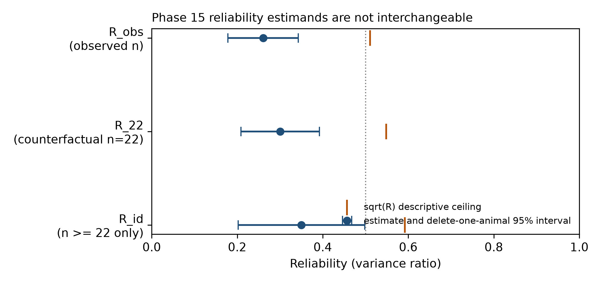
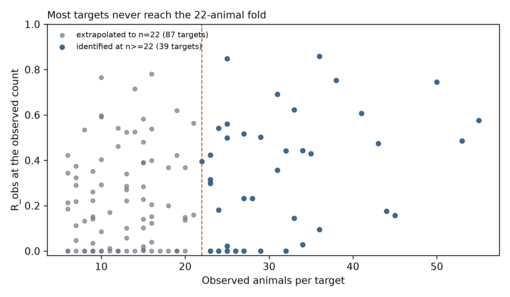
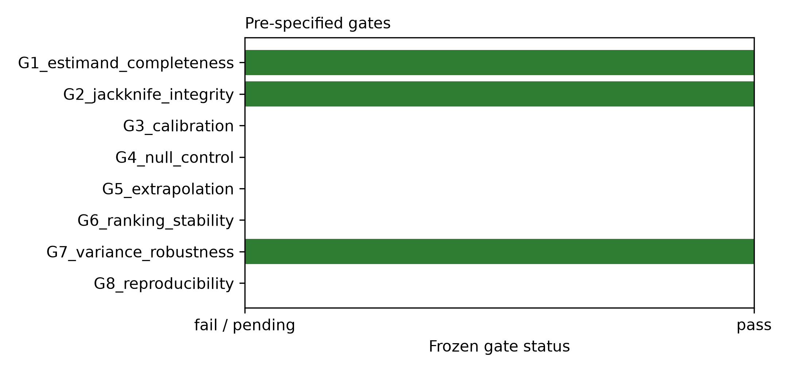

# Reliability without extrapolation: a three-estimand audit of a *C. elegans* repeated-stimulation atlas

**Status:** internal manuscript, not peer reviewed. This is a measurement audit,
not a causal or transport study.

## Abstract

The NeuroBranch benchmark reports a reliability ceiling for neural responses in a
repeated-stimulation atlas. The historical headline, `sqrt(R(22)) = 0.560`, was
computed from a reliability curve extrapolated beyond the observed animal counts
of most targets. Here we separate three estimands under a frozen protocol:
observed-count reliability (`R_obs`), a counterfactual at 22 animals (`R_22`),
and reliability on the identified subset with at least 22 animals (`R_id`).
`R_obs` is 0.2606 (delete-one-animal
95% interval 0.1782 to
0.3430; ceiling
0.5104) across 126 targets.
`R_22` is 0.3006 (interval
0.2087 to
0.3924; ceiling
0.5482) but is extrapolated for
87 of 126 targets. `R_id` is
0.3501 on
39 targets and is a different
population. The audit decision is **`not_calibrated`**. The 0.560 value is
retained only as a historical extrapolated point estimate, not as a bound.

## 1. Question

The benchmark's scores are bounded by measurement reliability. If the bound is
extrapolated, a score-to-ceiling ratio can look better than the data support.
The pre-specified question was: for the Randi repeated-stimulation atlas at 80%
responder coverage, what reliability is identified at the observed animal counts,
what is the counterfactual value at 22 animals, and what uncertainty and null
bias do those quantities carry?

## 2. Data and frozen choices

- Input: `reports/phase3/randi_trial_table_phase3.csv.gz`, SHA256
  `8186c96bcb33cdce15dc9ae88691e09fc596e42c5513310b6d6a636e4d5dd515`; 237639 rows.
- 126 eligible targets; 80% responder coverage; at least 6 animals per target.
- Primary variance treatment V1: one common one-event variance
  `omega^2 = 1.762913` from
  37644 eligible cells.
- Fold size 22; target-level estimands are unweighted means over targets.
- Uncertainty: delete-one-animal jackknife conditional on the fixed responder
  set; normal 95% interval. Bayesian bootstrap and null controls are
  cross-checks, not replacements.
- Calibration: 1,000 parametric
  replicates on the real missingness masks.
- All gates and the decision rule were frozen in
  `research/phase15_protocol.md` before the run.

## 3. Estimands

`R_t(n) = signal_t / (signal_t + (noise_t + interaction_t) / n)`, clipped to
`[0, 1]`.

1. `R_obs = mean_t R_t(n_t)` at each target's observed count.
2. `R_22 = mean_t R_t(22)`; targets with `n_t < 22` are counterfactual.
3. `R_id = mean_{t: n_t >= 22} R_t(n_t)`; a different target population.

| Estimand | Population | Estimate | 95% jackknife CI | Ceiling | Targets | Extrapolated |
|---|---|---:|---:|---:|---:|---:|
| `R_obs` | Observed animal counts (all eligible) | 0.2606 | [0.1782, 0.3430] | 0.5104 | 126 | 0 |
| `R_22` | Counterfactual at n=22 (all eligible) | 0.3006 | [0.2087, 0.3924] | 0.5482 | 126 | 87 |
| `R_id` | Identified subset (n >= 22 only) | 0.3501 | [0.2020, 0.4982] | 0.5917 | 39 | 0 |



## 4. Results

### 4.1 Most of the old headline is extrapolation

87 of 126 targets have fewer than 22 animals
(Figure 2). For those targets, `R_22` is a design counterfactual, not an
observed-data quantity. The observed-count estimate is
0.2606, and the identified-subset
estimate is 0.3501. The three values
answer different questions and none is a replacement for another.



### 4.2 Uncertainty

The delete-one-animal interval for `R_obs` is
[0.1782,
0.3430]. The Bayesian
bootstrap median is
0.2875 with a 95%
interval [0.2210,
0.3564]. The two-way
bootstrap is not used because it is biased on sparse animal counts.

### 4.3 Calibration and nulls

The calibration study reports coverage
0.9900 for `R_obs`,
0.9760 for `R_22`, and
0.9990 for `R_id`
(nominal 0.95; pass band 0.93--0.97). The failure is over-coverage: the intervals
are too wide, not anti-conservative. Null controls:

| Estimand | Permutation median | Permutation q95 | Sign-flip median | Sign-flip q95 |
|---|---:|---:|---:|---:|
| `R_obs` | 0.0961 | 0.1137 | 0.1072 | 0.1291 |
| `R_22` | 0.1224 | 0.1461 | 0.1369 | 0.1641 |
| `R_id` | 0.1067 | 0.1433 | 0.1117 | 0.1501 |

The null medians are 0.096--0.137 against a 0.05 threshold, and the `R_22`
sign-flip q95 is 0.1641; the estimator assigns apparent reliability to
structureless labels.

### 4.4 Extrapolation and ranking

The animal-half extrapolation check gives median absolute error
0.2040 and bias
0.0377; the frozen gate requires MAE <= 0.10
and |bias| <= 0.05. The half-split ranking check gives median Spearman
0.1264 (interval
-0.0211 to 0.2469;
top-10 Jaccard 0.1765).

## 5. Gate results

| Gate | Status | Requirement |
|---|---|---|
| `G1_estimand_completeness` | **pass** | all three estimands with target counts and extrapolation flags |
| `G2_jackknife_integrity` | **pass** | >=95% valid LOO replicates, status ok |
| `G3_calibration` | **fail** | coverage 0.93--0.97 for each estimand |
| `G4_null_control` | **fail** | median <= 0.05 and q95 <= 0.15 for both controls |
| `G5_extrapolation` | **fail** | half-split MAE <= 0.10 and abs bias <= 0.05 |
| `G6_ranking_stability` | **fail** | Spearman lower CI > 0.50 and top-10 Jaccard > 0.60 |
| `G7_variance_robustness` | **pass** | abs(V1 - V0) <= 0.05 for each estimand |
| `G8_reproducibility` | **checked at release** | manifest, hashes, validator, clean worktree |



## 6. Decision and interpretation

The decision label is **`not_calibrated`**. Calibrated interval:
`False`. Ceiling claim allowed:
`False`. Ranking claim allowed:
`False`. Extrapolation status:
`counterfactual_only`.

The defensible statement is descriptive: the observed-count reliability is
0.2606 with the reported uncertainty
and the audit label. The value `0.5600` is a historical Phase 11
extrapolation, not a bound and not a corrected estimate. No causal, transport,
digital-twin, foundation-model, animal-budget, or target-ranking claim follows.

## 7. Limitations

- The estimand is a variance ratio for a filtered responder population; a
  different coverage filter changes the population.
- The jackknife treats animals as exchangeable clusters and is conditional on
  the responder set selected at 80% coverage.
- The parametric calibration is an additive model; heavy-tailed
  misspecification is reported separately and is not evidence of robustness.
- The atlas contains repeated stimulation but not a new independent cohort; no
  external transport claim is possible.
- The two-way bootstrap is diagnostic only.

## 8. Related methods

The variance-ratio target is an intraclass-reliability analogue
(Shrout & Fleiss, 1979). The delete-one-animal uncertainty uses the cluster
jackknife (Efron, 1979), and the Bayesian bootstrap cross-check follows
(Rubin, 1981). These citations describe methods, not evidence for the biological
interpretation. A BCa-style diagnostic was prototyped and discarded because
delete-one-animal values are not a bootstrap distribution (deviation D1).

## 9. Reproducibility

```bash
python scripts/phase15_reliability.py
python scripts/phase15_card.py
python scripts/phase15_manifest.py
python scripts/phase15_validate.py
```

Artifacts are in `reports/phase15/`; hashes are in `manifest.json` and
`manifest.sha256`. The validator fails closed on schema, gate, estimand-count,
and artifact-hash inconsistencies.

## References

- Shrout, P. E., & Fleiss, J. L. (1979). Intraclass correlations: Uses in
  assessing rater reliability. *Psychological Bulletin*, 86(2), 420--428.
  https://doi.org/10.1037/0033-2909.86.2.420
- Efron, B. (1979). Bootstrap methods: Another look at the jackknife. *The
  Annals of Statistics*, 7(1), 1--26. https://doi.org/10.1214/aos/1176344552
- Rubin, D. B. (1981). The Bayesian bootstrap. *The Annals of Statistics*,
  9(1), 130--134. https://doi.org/10.1214/aos/1176345338
